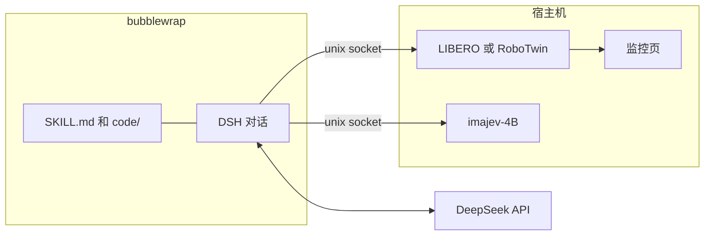

# DeepSeek for Robotics

让 DeepSeek 在仿真里写一个控制器，再把这个程序交出去跑。模型不直接输出关节角。它读技能文档，看相机和深度，写 `controller.py`，试跑，改，然后提交。提交之后，同一份程序在它没见过的初始状态上重放。

现在接了两个仿真：单臂的 [LIBERO-90](https://github.com/Lifelong-Robot-Learning/LIBERO)，以及双臂桌面的 [RoboTwin](https://github.com/RoboTwin-Platform/RoboTwin)。对话走 [DSH](https://github.com/deepseek-ai/deepseek-harness)（`@deepseek-ai/dsh`），仿真和视觉模型留在沙箱外面。

## 一次会话里发生什么



仿真进程占 GPU，握着场景。DSH 跑在 bubblewrap 里，只能看见当次工作区、插件和套接字，看不到以前的会话，也没有外网。需要看图时，沙箱里的工具把问题转到宿主机上的 imajev。监控页只播画面和状态，对话在 DSH 自己的页面上。

模型交上来的程序是 `code/<名字>/controller.py`，入口是 `main(ctx)`。控制器只能挪手臂、读状态、看相机和深度。开新场景、打分、提交都在它外面。

## 三种启动方式

三条进程可以同时开。端口不重叠。

| | 命令 | 监控 | 对话 | 技能 | 结束方式 |
|---|---|---:|---:|---|---|
| LIBERO 交互 | `python3 server.py` | [8765](http://127.0.0.1:8765/) | 3080 | `skills/libero-jev-control` | 模型调用 `finish`，本回合结束 |
| LIBERO 探索 | `python3 server_explore.py --task 46` | [8865](http://127.0.0.1:8865/) | 3180 | `skills/libero-explore` | 预算内自己 `reset`，`submit` 后在留出的初始状态上重放 |
| RoboTwin 探索 | `python3 server_robotwin.py --task adjust_bottle` | [8975](http://127.0.0.1:8975/) | 3380 | `skills/robotwin-explore` | 同上，评测 seed 从 `100000` 起 |

`--task all` 让一次探索会话覆盖该套件里的全部任务。`reset` 会同时换任务和场景。RoboTwin 的 50 个任务名和单轮步数在 [docs/robotwin-tasks.md](docs/robotwin-tasks.md)。

```bash
python3 server_explore.py --task 46 --budget 2400 --horizon 400 --gpu 0
python3 server_robotwin.py --task stack_blocks_three --budget 1200 --gpu 0
python3 server_robotwin.py --task all --eval-seeds 5 --gpu 0
```

RoboTwin 默认用末端位姿（`--action-type ee`）和光栅相机。`--raytrace` 切回官方光追，`--expert-check` 会先丢掉脚本专家自己也做不成的 seed。

## 目录

```
server.py                  LIBERO 交互会话
server_explore.py          LIBERO 探索和留出评测
server_robotwin.py         RoboTwin 探索和留出评测
plugins/                   DSH 插件，把仿真工具暴露给模型
  libero90/                交互：register、finish、步进、相机、深度
  libero-explore/          探索：reset、run、score、submit
  robotwin-explore/        同上，双臂
  imajev/                  视觉判断，模型在宿主机
skills/                    写给模型的技能，会话开始时拷进工作区
submissions/               已经提交、能单独阅读的控制器
docs/robotwin-tasks.md     RoboTwin 任务表
scripts/sync_skill.py      把最新 RoboTwin 会话里改过的技能拷回 skills/
```

`runs/`、`.dsh-home/`、`.socks/` 是当次会话的画面、对话和套接字，不进仓库。

## 跑起来需要什么

这棵树目前钉在一台机器上。Python、Node、conda 和 `LIBERO_CONFIG_PATH` 都写成了绝对路径，换一台机器要先改这些位置：

- 仓库根目录，现在是 `/data/changzou/deepseek4robotics`（`server.py`、两个探索入口、`plugins/*/cordis.patch.yml`、`scripts/sync_skill.py`）
- 三个 conda 环境：`ds4ro`（LIBERO）、`robotwin`（RoboTwin）、`imajev`（视觉模型）
- DSH：`/home/changzou/.nvm/versions/node/v24.22.0/bin/dsh`
- LIBERO 配置：`/home/changzou/.libero`
- `bubblewrap`（`bwrap`），用来把对话关进沙箱

第三方代码单独放在 `third_party/`，不进这个仓库：

| 目录 | 上游 | 谁用它 |
|---|---|---|
| `LIBERO` | [Lifelong-Robot-Learning/LIBERO](https://github.com/Lifelong-Robot-Learning/LIBERO) `8f1084e` | LIBERO 两个入口 |
| `RoboTwin` | [RoboTwin-Platform/RoboTwin](https://github.com/RoboTwin-Platform/RoboTwin) `ea8b211` | `server_robotwin.py` |
| `imajev` | [mohit67890/imajev](https://github.com/mohit67890/imajev) `318e8da` | 探索会话里的视觉判断 |

密钥只放在环境变量或 `.env` 里，文件名是 `DEEPSEEK_API_KEY`。`.env` 已被忽略。

```bash
cp .env.example .env
# 把密钥写进 .env，然后：
python3 server_robotwin.py --task adjust_bottle --gpu 0
```

监控页出来之后，终端里会打印 DSH 的地址。打开那个地址就是对话。

## 技能

每份技能是一段给模型的操作说明，加上它可以直接改的 Python。

| 技能 | 用在 | 要点 |
|---|---|---|
| `libero-jev-control` | 交互会话 | 深度对齐到基座，自己看图判断物体。在 butter → tray（task 56）上验证过 |
| `libero-explore` | LIBERO 探索 | 同一套几何，物体名字交给 imajev。预算默认 2400 步 |
| `libero-control` | 技能底稿 | 相机、夹爪、抽屉的测量笔记和分任务配方。交互入口现在用的是上面那份更短的技能 |
| `robotwin-explore` | RoboTwin 探索 | 双臂，按环节写控制器：感知、接近、下降、闭合、搬起。默认预算 1200 个规划动作 |

会话里改过的 RoboTwin 技能可以用 `python3 scripts/sync_skill.py` 拷回 `skills/robotwin-explore`。`--dry-run` 只打印差异。

## 已经交上去的控制器

`submissions/` 里是读得出来的成品，不是训练日志。

- `submissions/libero90/46_...butter.../`：把黄油放进托盘
- `submissions/robotwin/adjust_bottle/`：把瓶子头朝上拿起来
- `submissions/robotwin/stack_blocks_three/`：红在下、绿在中、蓝在上

## 许可

本仓库还没有选定许可证。克隆下来的上游项目各自保留原许可证，并且不包含在这次提交里。
