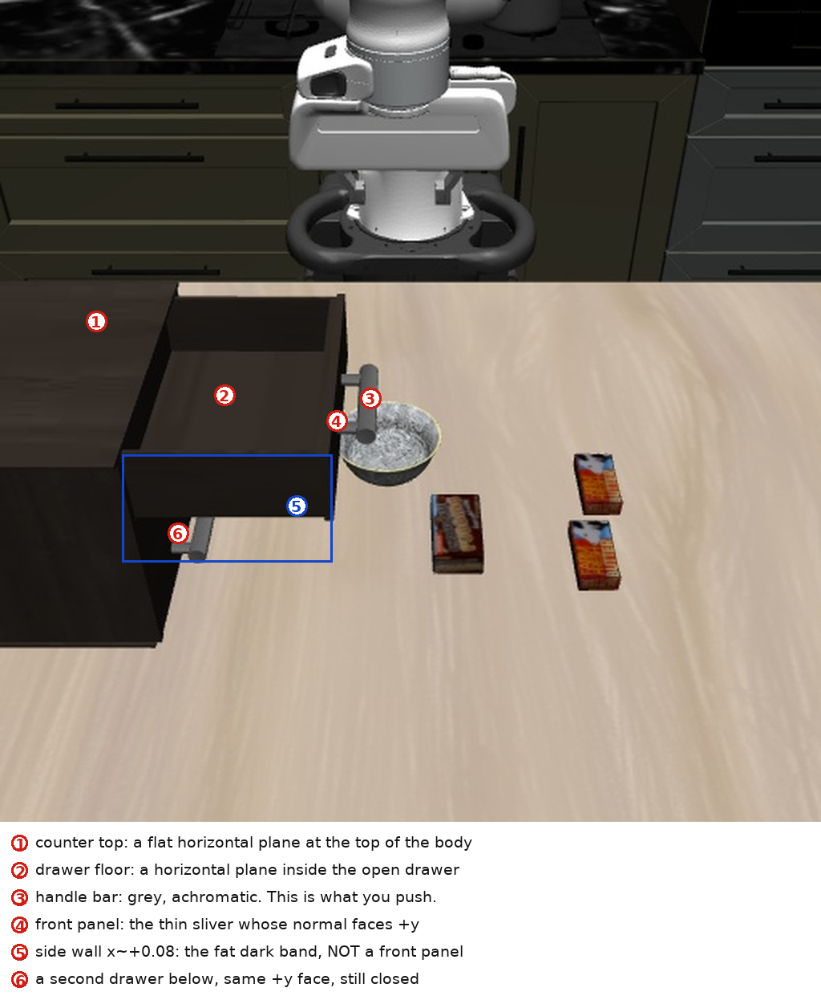

# REFERENCE — the measured atlas

> The **method** is `SKILL.md`. This file is the evidence and the derivations behind it.
> Open ONE lettered section, when the method tells you to — not before.
>
> * **A** asset anatomy, per scene (the part that transfers between draws is the *spacing*;
>   the offsets do not)
> * **B** diagnostics and identification: the long form of every "it stopped" and "what is
>   that" signature
> * **C** metrology: what to measure, how, and the derivation for each placement number
> * **D** library notes: the measured stories behind the `rig.py` functions
> * **E** demo files: how to mine a `<task>_demo.hdf5`, if one exists
> * **F** controllers to copy, by task

---

## A. Asset anatomy per scene

The relationships transfer between draws; the offsets do not (y moved 1.4 cm between two draws
of the same chest). Read these as *scale and structure*, then measure the offsets from depth.

### A1 KITCHEN_SCENE2 — the two-drawer chest (tasks 1, 3, 4, 5, 16, 17)

| quantity | measured | notes |
| --- | --- | --- |
| table plane (height origin) | **0.9498** | one flat plane; the mode of z over open table |
| fronts' plane | **y −0.229** | `S = +1`: drawers open toward **+y** |
| drawer fronts | one flush plane | the front panel is a 1 mm y-bin with 600–630 px, two of them 1 400–2 000 — weak support, so keep `min_pixels ≈ 150` |
| counter / rim plane | **1.175** | the 10 000-px plane whose front edge tracks the drawer (open −0.078 → home −0.229) |
| drawer floor | **1.113** | `n ≈ 5 600`; its *disappearance* is the strongest "closed" signal (§B3) |
| panel band | 1.105…1.173 | |
| top handle bar | **1.139…1.147**, protruding to y −0.045 | bars stand **3.2 cm** proud, **8 cm** apart, one per drawer |
| bottom (lowest) bar | **0.9949…1.0047** | the bottom drawer's identity is the LOWEST bar |
| drawer travel | **0.152–0.1605** | `states[:,26]` on 50 demos: 0 → −0.16049 |
| butter (task 4) | 7.0 × 4.4 × 1.8 cm, tops 0.9676/0.9677 | two identical, 7 cm apart in x; +x is the "front" |
| chocolate pudding (task 5) | 8.1 × 4.9 × **2.8** cm, top 0.9779, rgb (70,49,40) | the odd one of three packages |
| speckled bowls (16/17) | rim **1.0010**, fitted **R 0.0546** (0.0545/0.0546/0.0547), visible height **5.13 cm**, `h_bowl` **0.0499** | three identical, ordered by **x** (front = max x) |
| bowl rim annulus (the destination) | radii **0.053–0.0566** → a **3.6 mm** ring | the only support surface in a stack |
| bowl foot ring | **r ≈ 0.028** | so a released upper bowl meets the annulus in one point ~27 mm outboard of its COM and tips (−14.8 mm / 9.7°) |
| bowl outer wall | a **cone, ~21° half-angle** | an upright rim presents 21° (pinches); at 26° tilt it presents 47° and the pads slide through |

### A2 KITCHEN_SCENE3 — stove, knob and pan (tasks 18, 21)

| quantity | measured | notes |
| --- | --- | --- |
| stove plate | **0.9747** (mode; the median read 0.9715 on a bevelled plate) | plate is pale grey, achromatic mean 120–130 — **inside** `Scene.arm` |
| raised spiral burner | **0.9800** | 5 mm above the plate: that is what a pan lands on, and it is half the placement tolerance |
| cook region (`*_cook_region`) | the burner's own centre | a pan flat on the burner at 0.4° still failed with its centre 7.5 cm off |
| frying pan (18/21) | **R 0.0981**, `h_pan` **0.0372** (lip 0.9870 − table 0.9498), base R 0.075 | 20 cm; the lip annulus is r 0.0957–0.1007 (5 mm wide) |
| pan handle | same colour as the pan, rises to **z 1.084** | breaks every ring fit on a *standing* pan (`R 0.152`, res 10 mm) — use a Hough (§C) |
| knob | vertical-axis joint, **hub top 0.972**, fin top **1.0089**, fin 7.8 × 2.6 cm | the blade is a 0.4 mm sheet to `\|s\| ≈ 0.030`, then a **24 mm block** at `s = +0.030…+0.050` |
| burner lamp | `r > 110`, `r > g+50`, `r > b+50` over the burner's box | 0 px off → ~1 440 px on, lights at ~22° of knob rotation; **sufficient but not necessary** |

### A3 KITCHEN_SCENE4 — the mirrored white chest (tasks 22, 23, 24, 26)

| quantity | measured | notes |
| --- | --- | --- |
| table plane | **0.9498** | |
| fronts' plane | **y +0.2161…+0.2168** | `S = −1`: drawers open toward **−y**; every `+y`/`−y` in the drawer sections mirrors |
| counter | **1.1747** | `top_face_front_y()` returns **None** here — `chest_window` anchors on the fronts instead |
| drawer floor | **0.973–0.974** | above the table by 2.3 cm (the box sits on the carcass) |
| drawer box interior | **x −0.1315…+0.0805** (21 cm), back wall at **y +0.2286** (PAST the fronts' plane — the box slides into the cabinet) | the visible floor span is 15 × 12 cm, an inner bound, not the mouth |
| open drawer's front panel | y **+0.0627** (travel 0.153), z 0.949…1.034 | its top face is the 1.033 plane a descending hand must clear |
| panel top / box rim | **1.033** | the interior is only 6 cm deep |
| bars (closed, above) | zc **1.0702** and **1.1422**, front y +0.1851 | they stand 3.1 cm proud of +0.2157 |
| open drawer's bar | z **0.9964…1.0047**, front y +0.0307 | and the closed drawer above overhangs the mouth at **1.0670…1.0735** to y +0.185 |
| interior colour | bright, **mean ≈ 224**, chroma < 20 | i.e. **inside `Scene.arm`**: `planes()` never sees the floor, `face_bins` cannot see the walls, `mouth_walls` must not exclude arm |
| bowls (24) | rim **0.9995**, **R 0.0546**, `h_bowl` **0.0495**, lip top face spans radii 0.0530–0.0558 | the lip is 3 mm wide, so the fitted R is the lip's MID radius |
| table clutter (24) | two leaning boards y −0.19…−0.44, top z **1.19…1.29**; a bottle at (−0.15, +0.05) | the boards made the −y rim unpinchable |
| **FREE AIR above the open bottom drawer (26)** | panel inner face **y +0.0700** (top 1.0339) → free y 0.070…**0.1851** (the bars) = **11.5 cm**; bars' z bands **1.0666–1.0735** and **1.1397–1.147** | the mouth is 21.2 cm wide but the hand is 15.7 cm tall: *this window*, not the mouth, limits a wrist-down placement |
| wine bottle (26) | **lying**; axis point (−0.316,−0.119), dir (0.716,0.698) = **44.3°**, len **0.156**, diameter **0.045**, axis z **0.9722**, base (−0.362,−0.163) to neck (−0.250,−0.054) | `rig.axis_from_ridge` on a dark-green class (G−R ≥ 4, G−B ≥ 4). The same bottle appears in task 24's clutter at (−0.15,+0.05): its placement is drawn per episode |
| hand's vertical stack (26, home pose) | pads **+0.043…+0.065**, a 1 cm bar **+0.075…+0.095**, a 3 cm block **+0.10…+0.14**, a 7.6 × 20 cm box **+0.135…+0.20** — **15.7 cm tall, 20 cm long along the jaw axis** | `rig.hand_stack`. The 20 cm length is what makes an 11.5 cm window impassable at any `eef_z` |
| reach envelope (26) | pad bottom bottoms out at **0.99 for x ≤ −0.40** (eef_z 0.949 at x −0.45, 0.947 at −0.40) and still reaches **0.958 at x −0.335**; at x −0.50 a commanded descent ended at x −0.455 | measured by commanding descents at three xy (`code/bottle26` `reach`). The tell is a descent that **rises** |

**Task 26's episode (1000/1000, failed) is the cautionary one:** two ploughed closes pushed the
bottle 5 cm and then 24 cm from the plan's pose — outside the reach envelope — and ~120 rows went
to dragging it back, so the budget ended with the bottle on the table at (−0.44,−0.04). The place
plan (`SKILL.md` §7: free air → residual drop) was never executed: treat its 10–12 cm drop as a
*hypothesis* consistent with task 24's measured 15 cm free fall, not as a measurement.

---

## B. Diagnostics and identification

### B1 A stopped motion — the full signature table

Three one-row tests, **in this order**: (1) `dz = +1` at the same pose; (2) `droll = +1`;
(3) `dx = ∓1`. What answers separates the causes:

| what answers | what it is | measured evidence | fix |
| --- | --- | --- | --- |
| nothing moves, but a rotation still turns the wrist and `+z` is dead | **the hand's bottom is standing on a horizontal face**: a horizontal scene face at exactly `eef_z + 0.082` (bar top, counter, drawer rim, a table object's top) | task 5: all axes dead for 120 rows at `eef_z 1.0645` = bar top 1.1469 − 0.082 while `droll` still turned; chasing that "freeze" cost ~215 of the 278 grasp rows | look for a face at `eef_z+0.082`; descend **in front of** it (§SKILL) |
| `+z` moves, `-z` does not | controller/freeze | `-z` inert 0.000–0.001 m at particular heights, returns at the same spot after a retreat | row-alternating roll kick on top of the quaternion servo |
| `+z` moves, nothing else, one horizontal axis inert **below x ≈ +0.02** | stretched arm (`j4 ≈ −0.07`, the straight-elbow end of `[-3.07, −0.07]`) | task 16: `dx=−1` inert at 0.4 mm/row below x ≈ +0.02 at y 0.13–0.23, j4 pinned, pitch drifting −0.05 → −0.16; ~200 rows, incl. a 38-row transport that ended 8 cm short | **rise first** (`goto(x_now, y_now, 1.35–1.42)` folds j4 to −1.5…−2.0), then cross in xy, then descend |
| `+z` alive, `rot_err` climbing, one axis inert | the orientation servo is starving the position servo | task 22: a 25 cm cross stalled with a 0.15 m x-residual while `rot_err` climbed 0.082 → 0.245 | rotate in place to **≤0.04 rad** (re-pass if it drifts), then translate |
| `+z` alive, `rot_err` small (<0.05), **nothing in the depth within 4 cm of the pads**, `arm_low` clean | **short reach near the base**, not contact | task 24: a descent to an open drawer died at `eef_z 1.108` at (x +0.02, y +0.16) with the payload 13 cm up; task 21's carry jammed at (+0.03, 0.10, 1.25) | aim/shift **−x** (the pose that works: (−0.018, 0.10, 0.97)); a rise only re-enters the jam |
| the descent stops with `+z` alive, `rot_err` rises, the eef **drifts along one horizontal axis**, and the blocker is 0.15–0.2 m BEHIND the eef | the **hand block** on table clutter behind the fingers (a leaning board, a bowl, a bottle) | task 23: `yaw(Q_HOOK,180)` put the hand's low ridge 0.19 m behind and 0.015 m below `eef_pos`; a 5 mm height sweep moves that lever by nothing | corridor change: descend where the palm is clear → cross at the working z → descend the last 2–5 cm |
| a pure-rotation row produces no motion | normal | a 1.5 mm stall test fires on every rotation-only row | gate any stall detector on `‖rot_err‖ < 0.10` |
| the push converges with a 0–1 mm residual | empty space, not contact | task 6: `bar_front − 0.005` converged 0.4–1 mm short and moved the panel 0.000 m; `bar_front − 0.015` stalled with a 10–12 mm residual and worked | require ~10–12 mm of residual, then the 4–6-row biased probe |
| x/y jam inside an open box while z still moves | a **wedge**: the pads went over the rim and are inside the box | — | pure `+z` above the rim, then out of the mouth, then re-approach lower |
| the descent goes **UP** while commanded down, and the xy residual will not close | the target xy is **outside the reach envelope**; OSC trades the error between axes, so the arm slides along the envelope and the z servo loses | task 26: commanded to (x −0.53, y +0.04, `eef_z` 1.172) the arm rose to 1.209 and stopped 5.5 cm short in x; the same xy held fine at z 1.19. Envelope: pad bottom 0.99 at x ≤ −0.40, 0.958 at x −0.335 | move **toward the base** until the xy closes; the z then follows. Do not push z harder |

**Two free amplifiers.** `rot_err ≈ 0.30` stalls the whole arm until `rotate_to` levels the tool
(task 21). And a *rotation-only* row walks the eef 4–8 cm (7 rows of 20° about world y moved it
4–8 cm in −x and 5 cm down), so re-read `eef_pos` after every rotation and recompute the target.

### B2 What you are looking at — identification traps



* **A side wall looks exactly like a front panel.** On this cabinet the drawer's side wall
  (normal +x) renders as a fat 130 × 40 px dark band while the front panel (normal +y) is a thin
  sliver. Pushing into the band slides the arm along a wall. The plane offsets settle it, and the
  face that carries the handle is the panel (the bar's arms leave the panel).
* **The gripper's shadow looks like part of the gripper.** Big dark shapes near the wrist
  unproject onto the table plane (z ≈ table). If it lands on the table it is a shadow, not a
  contact, an obstacle, or a pad.
* **The small grey block near the wrist is a decoy, but a +0.04 pad reading is not.** The block
  is achromatic and pad-sized and inflates a loose box test; a later session measured the same
  ~+0.04 offset from the arm's actual lowest pixels at three poses, so do not dismiss a number
  because a decoy could explain it — shrink the box instead.
* **"The object is still there" is easy to fake with a brightness mask.** After a lift, a grey
  mask over the old spot also catches the wood grain (mean 75–178) and reported the bowl still
  present after a *correct* grasp. The tells that it left: the blob's `zmax` collapses, its
  extent grows past the object's diameter, and — the check that never lied — the **picture**.
* **The arm's dark parts are "not arm-coloured" and will be picked as the carried object.** The
  `arm` class is *achromatic and `mean > 70`*; the forearm's shadowed side reads `(39,39,39)` and
  the wrist's dark blocks `(32,32,32)`, so any blob hunt that only excludes `Scene.arm` returns
  them. Measured on task 16: the arm came back as an 8 cm tall blob at `z 1.288–1.350` and a
  picker that only checked "z extent > 35 mm" chose it, which set a bogus carried-bowl height and
  drove the bowl into the table. Filter carried blobs on **all** of: `mean` colour 58–140 (the
  speckled bowl is `(74,73,64)`), z extent 35–68 mm, and a rim fit whose R lands in the object's
  own range (0.045–0.065 for these bowls). The real bowl's numbers were conspicuous once
  printed — 5.13 cm tall, `R 0.0546`, `rgb (76,75,65)` — so print every candidate with all three
  and choose, never take the biggest.
* **A bowl can end up wearing the hand.** Task 17's released bowl got scooped onto the hand
  block and then rode as a **collar around the wrist** (z 0.30–0.38 above the table, the
  hand's underside at `eef+0.088`); a later close left it **clamped rim-to-rim with a second
  bowl** (`gq` 0.0048 — two 5 mm rims — and the pair then moves with the arm). Consequences:
  an "object on the hand" scan must exclude the arm's *dark* parts (mean < 70, rgb 42–55) or
  the measured bbox drifts ~1 cm per move, and an accidental **inversion is an opportunity,
  not a loss** — an inverted bowl is a rim-on-rim seat waiting to be lowered onto the
  destination (that state's lowest point is its rim, i.e. exactly the other bowl's rim
  plane).
* **A scene can hold a second object of the same colour and shape class, and only one of them
  is the one the instruction names.** Task 18's table carried the 20 cm frying pan *and* a 7 cm
  black disc with a stubby raised handle standing behind the stove (top 1.009, x −0.26…−0.165).
  With no spatial qualifier in the language, the discriminators are **size and the handle**:
  "the frying pan" is the one with the long flat handle and the hanging hole, and a 7 cm disc is
  not a frying pan on any of these assets. Two more traps from the same draw: `objects_on_table`
  returns **nothing at all** here (it wants a chromatic, mid-bright object, and a black pan and a
  grey stove are neither), so a black-object scene has to be segmented by hand; and the decoy sat
  1.1 cm behind the target's edge, so the *target aim* must be chosen to clear it, not just the
  grasp.
* **A mask that only excludes `Scene.arm` still contains the robot — and it merges the object with
  the scenery.** Task 26 needed a *height field* of the table (to test whether the hand could reach
  a pose). Built from `~Scene.arm`, it kept a tenth of the arm's own pixels — the `arm` class is
  `mean > 70`, so the forearm's shadowed side and the wrist's dark blocks survive — and one leaked
  pixel at `eef_z+0.23` produced a 1.4 m "obstacle" at (−0.22,−0.065) that flagged 300 of 5 650 arm
  points as blocked, i.e. it vetoed a pose that was clear. The same class also merged the dark-green
  bottle into the black cabinet, which returned a **0.215 m "length" for a 0.156 m bottle**. Two
  fixes, both 0 rows: **(a)** build such a field from **chroma** (`max−min > 30`) — the robot is grey
  to within 2, measured (37,38,36), so it cannot survive — and **(b)** choose the object's class by
  the *hue relation* that separates it from its nearest distractor (the bottle `(6,14,5)` gives
  G−R = 8, G−B = 9 against the grey's 1 and 2), then **check the measured extent against the size the
  object can possibly have**. A length, a diameter or a height that cannot exist is a mask bug, and
  it is always cheaper to find it in the probe's print-out than after the grasp.

### B3 Closing a drawer — the failure table

Failure modes, in order of frequency:

| symptom | cause | fix |
| --- | --- | --- |
| stalls 2–5 mm proud, `+z` rise weak, face below the frame plane | **hand's face above the panel band** riding the frame/counter edge | drop 4–5 cm, push the **bar** (`eef_z ≤ bar_bottom − 0.082`) |
| pads rode over the rim, x/y jam inside the box | pads too high (pad offset under-estimated) | `+z` above the rim, `+y` out, re-aim lower |
| arm travels, nothing moves, bar offset unchanged | pads below the band, pressing the closed drawer underneath (one drawer-depth further back) | raise by the band height |
| eef dead, no motion anywhere, `+z` also dead | controller freeze | rise, back out, reset the quaternion, re-plan |
| eef dead while *rotations* still turn the wrist, and `+z` is dead too | **not** a freeze: the hand's bottom edge (`eef_z + 0.082`) is standing on a horizontal face — the handle bar's top (1.1469) during a descent, or the counter during a drop | look for a face at `eef_z + 0.082`; descend in front of the bar (§3), not on top of it |
| bar offset unchanged after 0.05 m of push | pads missed the bar | re-measure the panel plane *first* (a stalled eef is not evidence), then retreat and re-aim |
| **the descent stalls 10–15 cm above the target, `+z` still rises, the eef drifts sideways, and nothing is within 4 cm of the fingers in the depth** | the **hand block** is standing on table clutter *behind* the eef (a leaning board, a bowl, a bottle) — not a freeze and not the drawer | do not sweep the height: change the corridor (`s.arm_yz()`, `rig.above_table_map`), i.e. descend where the palm is clear, cross at the working z, descend the last few cm (§2) |
| **every plane reads plausibly but is 0.15–0.30 m off; a "bar" 22 cm wide and 7 cm tall; travel 0.31 m** | the chest's OUT axis is not +y (a mirrored scene, §1) | `rig.drawer_axis(s)` first, then `front_face_on` / `handle_bars_on` / `panel_home_on`. Never "fix" it by adding an offset: the sign is the bug |
| **the goto stalls with a ~0.15 m residual on ONE axis while `‖rot_err‖` climbs past 0.2** | the rotation was left half-done (tol 0.10) and the position servo is being starved by the quaternion servo (§2) | rotate in place again to **≤0.04 rad** (re-pass if it drifts), then the order is level → rise at the current xy (z ≈ 1.34) → cross in xy → descend vertically in two stages |
| the panel is home but the **hand is inside the cabinet** (fingers past the fronts' plane) | the push ends with the tips 3 cm in front of the frame *on the bar*, but a bad approach can carry them past it | leave along the OUT direction first at the same z (`u − 0.24`), then rise: the fingers point inward, so pulling out slides them below the bar instead of dragging it |

### B4 Mirroring, and three library traps that only appear on it

On a `S = −1` chest, the sign-hardcoded helpers **do not fail loudly: they return plausible
numbers 0.15–0.30 m out.**

* `front_face_y` takes *max y*, which on a −y-facing chest is the **closed** plane: it reported
  0.2167 for a drawer that was 15 cm OPEN — a home verdict on an open drawer, no error anywhere.
* `handle_bars` on task 22 returned a 22 cm-wide, 7 cm-tall "bar" that was the drawer *box*
  behind the panel, and the travel read 0.31 m against a true 0.149 m.
* `closed_reference_y`, `panel_face`, `panel_home`, `drawer_closed`, `push_to_stop`,
  `push_tips_to_stop` are all `S = +1`-only.

So measure `rig.drawer_axis(s)` first and use the general layer
(`front_face_on` / `handle_bars_on` / `panel_home_on` / `face_bins` / `hook_quat_toward`), or
write every relation in `u = S · coord[axis]`. Three more traps, from the same episode:

* `probe_pull_biased` returns `move_u = S·Δy` as well as the raw `move`: on a −y-opening drawer
  the raw `move` is **negative for a drawer that opened**, so scoring it directly says "not
  engaged" on a 4 cm pull.
* `handle_bars_on`'s bar `x` span is p1/p99: with min/max, five stray pixels turned an 8.9 cm
  bar into a **19.4 cm** one whose mid was 5 cm off — and a 6.8 cm-apart finger pair aimed at
  that mid-line misses the bar entirely.
* `drawer_band_for_bar` takes either key convention via `rig.bar_zs` (`handle_bars` returns
  `bar["z"]`, hand-rolled `find_bar`s return `z0/z1`; mixing them is a bare `KeyError` at the
  end of an otherwise fine probe).
* `handle_bars_on(..., drop_arm=True)` deletes the bar you are pressing once your hand is inside
  0.12 m of it — a "no bar found" *at the press pose* means the arm is there.
* `Scene.arm` matches pale scene faces: a counter top unprojects as thousands of "arm" pixels at
  z ≈ 1.17, so any arm-mask extent near the fronts has to be read as "hand **or** counter".
* `Scene.top_face_front_y()` can return **None** (KITCHEN_SCENE4 has no 3 000-px horizontal
  plane in its default box). The old `chest_window` fallback (`nanmax(Z)`, `cy = −0.24`)
  silently produced a band at z 1.27–1.41 — a metre above the drawers — so every `front_face_y`
  it fed read the wrong plane. It now anchors on the measured fronts and prints
  `anchor=fronts`; **`anchor=NONE` means the window is worthless.**

### B5 The evidence lines the rules compress

One line per rule in `SKILL.md` §3–§5, with the numbers the rule was measured on. If a rule ever
looks wrong, start here.

* **Pad offset.** Six wrist-down readings **0.0406–0.0470**, plus **0.0426** on one episode and
  **0.0405** on task 5 (library `PAD_DZ = 0.0431`). Task 21's box ladder: 0.045 → **+0.0575**
  (clips the far finger), 0.050 / 0.060 / 0.075 → **+0.0417** (agreeing pair).
* **Pitched `pads()`.** At Q_HOOK it read a flat **+0.0586** at `eef_z` 1.0993 (boxes 0.03/0.04/0.045
  → 0.0606 / 0.0586 / 0.0586, spread 2 mm) and that is the **palm**, 3.5 cm above the real finger
  surface. At two other hook poses it read **+0.006** and **+0.0215** *above* the eef, with the jaw
  pair at (−0.029, −0.021) and (−0.044, −0.016). A pitched `pads()` at `eef_z` 0.9678 (table 0.9498)
  read **−0.0199** (the table) and an insert derived from it sat 5.5 cm above the bar; at `eef_z`
  1.1058 the same call is a flat **+0.0467** (+0.0487 at half 0.03, +0.0332 at 0.06).
* **Hand lead.** 0.111 m (0.1076 in one failed close: eef y −0.1179 against a panel at −0.2255;
  0.087 m on an older reach). The front finger's outer face is at `eef_y` −0.063…−0.076, spanning
  `eef_z + 0.043 … + 0.075`.
* **Hand plate, per 2 cm y-cell** (task 24, `rig.hand_slab`, eef_y −0.1124, eef_z 0.9923):
  y −0.232 → 1.0955, −0.212 → 1.0778, −0.192 → **1.0582** (pads), −0.112 → 1.0739, −0.052 →
  1.0656, −0.032 → 1.0717, −0.012 → 1.1256. Lead 0.11–0.12 m, back 0.09–0.12 m, underside
  `eef+0.07…+0.09`.
* **A flat grasp, worked** (task 4, 65 rows). Butter centre (−0.0185, 0.2097) → eef target
  (−0.0015, 0.2242, **0.9132**), i.e. the eef 3.7 cm *under* the table plane; 19 rows over it at
  z 1.20, 28 down, jaws settled at `gripper_qpos` **0.0195** on a 4.4 cm stick, 11 to lift. Task 5's
  2.8 cm box aimed the pad bottom at `table + 0.013` (`eef_z` 0.9225) and settled at 0.0240.
* **Drawer y is per-episode.** Fronts −0.229 on one draw, **−0.2428** on another (1.4 cm); one
  chest read a **0.31 m** travel against a true 0.149 m because `handle_bars` found the box behind
  the panel. "Front-most" is not "biggest": a chest's own back face read **−0.249** with 372 px while
  that drawer's panel sat at −0.083 with 263 px.
* **Close verdicts, the numbers.** Task 22's pushed panel homed at **0.2183** against a closed
  sibling at **0.2163** (2 mm *past*, which is correct); task 5's pushed top panel at **−0.2305**
  against a sibling at **−0.2289**, with a 124-px noise bin at **−0.2285** that the max-y rule
  picked. `drawer_closed` was true with the drawer 15 cm out when a face 1.5 cm behind the body plane
  made `min(faces) ≤ body_y + 0.015` and left `mid` empty. A 12-row jaw opening shifted a released
  bowl **+3.8 mm** in y; a hand's-face aim of `bar_top − 0.088` asked for `eef_z` **0.902** with the
  pads at **0.946** (under a 0.9498 table) — a bottom drawer needs the tips at **0.9696**.
* **Task 21's metrology.** The knob's fin was 7.8 × 2.6 cm on a hub whose top is 0.972 and whose
  flat face is at z **1.0089**; **46 mm** of push travel and a **98 mm**-out contact point moved it
  2.2° per 25° of yaw. The pan is the same 20 cm asset as task 18 (R **0.0981**), its COM **98 mm**
  from the lip, its rim's two ends differing by **46 mm** at 28°, and `h_pan` **0.0393** from the lip
  face (the dark-band Hough reads 0.0348 — 3–4 mm low). A 20 cm pan in a 15 cm drawer mouth leaves
  **28 cm** of ... nothing: it does not fit sideways, which is why the placement is a rim aim.
* **Replay calibrations.** Task 6's replay tracked to 2 mm with a constant **+1.8 cm** y offset; a
  growing offset means the draw changed, not the placement.
* **Row-rate sizing.** A `descend` clipped to `a[2] = −0.12` moves only **~1.4 mm/row**
  (`−0.22` → 2.4 mm, `|a| = 1` → **12–14 mm**), so a 45-row cap covered 6 cm of a 28 cm descent and
  the jaws closed 23 cm above the bowl (`gq` 0.0015). A **diagonal** press for 18–22 rows at
  `z` 0.9499 stalls with a 10–12 mm y residual; a single dead axis (`dx = −1` for 30 rows with a
  0.07 m x error) does not clear by pressing. A 2 rad wrist error costs ~25 rows, and there are
  ~35 rows in a bottom-drawer close with the tips.
* **The third jaw-offset reading** was **(−0.0197, −0.0138)** against the library's
  (−0.0140, −0.0151) — hence "good to ~5 mm". **Pitched pads**: at `eef_z` **0.9877** (table
  0.9498) the reading was 0.9678 → offset −0.0199, and an insert derived from `bar_zc − offset` =
  **1.0197** sat the fingers 5.5 cm above the bar. **`drawer_closed`'s tuples** on an opened drawer:
  `[(-0.080, 610), (-0.245, 323), (-0.230, 181)]` → closed `[(-0.230, 1814)]`.
* **The pinch is a ruler, and the jaws shove.** `|jaw centre → rim centre|` **0.0538** against a wall
  mid-radius **0.0528**. Opening the jaws sweeps the inner pad −y at ~**0.003 m/row** and drags the
  rim: a released bowl shifted **+3.8 mm** in y over 12 open rows — enough to walk a foot edge off a
  3.6 mm annulus.
* **The press, on the bar (task 6).** Presses at 0.955 / 0.965 / 0.971 / 0.975 converged in y at
  **−0.2156…−0.2166** with a ≤1 mm residual and moved the panel **0.000 m**; 0.9499 stalled at
  −0.2166 with a **12 mm** residual and moved it **4.4 cm**.
* **The drawer's own trio.** One draw: panel **−0.2305**, frame **−0.2285**, closed sibling
  **−0.2295** — the 1–2 mm relation is what matters and it is smaller than `panel_face`'s
  tolerance. Task 4's open mouth was x −0.128…+0.008, y **−0.243…−0.101**; the close verdict's band
  is `band_z=(1.105, 1.176)`.
* **Rotations and contact.** A 90° pitch commanded while translating stalled with a 0.44 rad error
  that then **grew back to 0.49**. Task 17's contact test: Δeef **−1.26 mm**, Δbase **−0.59 mm**,
  with the destination shoved 8 mm. Levelling measured **14.0° → 1.7°** in 4 rows and 12.6° → 0.2°
  in 3; a 22 mm `[align]` goto re-tilted the bowl **1.3° → 17.9°**.
* **The 17° lock, all four pairs:** tool 2.6° → bowl 16.9°; tool 17.1° → bowl 1.2°; tool 3.4° →
  bowl **17.0°**; tool **17.2°** → bowl 1.2°.
* **A low eef over a raised surface.** Task 21 at `eef_z` **0.937** (pads at 0.98–1.00 over the
  stove's plate 0.974): `pads()` read **+0.0129** and `jaw()` a centre 7.5 cm away with a 10.7 cm
  "gap" — both are the plate's top, not the fingers.
* **A 20 cm pan hangs at 27.5–28.3°**, normal (0, +0.46, **+0.89**) with its +y side low; free hang
  would be `atan(0.098/0.022)` ≈ 77°, so the pinch holds about two thirds of it. `pads()` at its
  home pose (jaws open, `2·gq = 0.0679`): half 0.045 → **+0.0575** with 6 390 px (the box clips the
  far finger), 0.050 / 0.060 / 0.075 agreeing at +0.0417. Its descent stopped at `eef_z` **1.0972**
  (task 5; task 4 at 1.0957), and the column then read the hand (~**1.23**), not the object.
* **Camera endpoints, no rows:** `http://127.0.0.1:8766/frame.jpg` (agentview) and `/wrist.jpg`
  (`robot0_eye_in_hand`), plain HTTP, tens of ms.

---

## C. Metrology — what to measure, how, and why

**Where the numbers come from.** Every placement value printed in this file was measured on
ONE draw of one task, and a draw is redrawn every session: the fronts' plane, the bars' z
bands, the x origin and the counter's y all move by 1–30 mm, and the fronts' y moved 1.4 cm between two
draws of the same chest. So treat every number here as *scale*, never as a value to command.
What transfers is the **anatomy** (one handle bar per drawer, the bars proud of one flush front
plane, the bars ~8 cm apart, the lowest bar is the bottom drawer) and the **derivations**, each
one depth call deep: `rig.chest_window` (counter's front edge → the chest's x/y window and the
fronts' z band), `rig.front_face_y` (the fronts' plane), `handle_bars` (one bar per drawer),
`rig.drawer_band_for_bar` (that drawer's own z band).

**Planes, by normal.** A face is identified by its normal, not by its apparent size or
darkness. Bucket pixels by surface-normal axis, require **100 pixels** (a 44-pixel cluster is
the arm or whatever you are holding), and **exclude arm-coloured pixels** — the depth contains
the robot, and during a push the gripper's own front face moves exactly like a panel would.

```python
du = np.zeros_like(pts); dv = np.zeros_like(pts)
du[:, 1:-1] = pts[:, 2:] - pts[:, :-2]; dv[1:-1, :] = pts[2:, :] - pts[:-2, :]
n = np.cross(du, dv); n /= (np.linalg.norm(n, axis=2, keepdims=True) + 1e-9)
region = (pts[:, :, 2] > 0.96) & (pts[:, :, 2] < 1.35)
for axis in "xyz":
    a = "xyz".index(axis)
    m = region & (np.abs(n[:, :, a]) > 0.85) & ~arm
    vals = np.round(pts[:, :, a][m], 2)
    uniq, cnt = np.unique(vals, return_counts=True)
    for o in np.argsort(cnt)[::-1][:5]:
        if cnt[o] < 200: break
        sel = m & (np.abs(pts[:, :, a] - uniq[o]) < 0.006)
        uu, vv = np.where(sel)
        print("%s=%+.2f n=%d u[%d..%d] v[%d..%d]" % (axis, uniq[o], cnt[o],
              uu.min(), uu.max(), vv.min(), vv.max()))
```

Name what you find in this order: horizontal planes (counter, drawer floor, rim), the vertical
faces bounding the movable part, then the body's.

**The height origin is not the biggest horizontal plane.** Loose objects 2–4 cm tall
contribute their own buckets: on task 3 the top z buckets were 0.965 and 0.975 while the table
was 0.9498 and those two planes were the objects. Read the origin off a coarse grid of the raw
depth (every ~32 px over open table) and take the mode, then check the two rig tests in §1.

**Cache the raw material once.** One `libero_depth` payload + `frame.jpg` contains every number
below; save the decoded depth, unprojected points and RGB to `experiments/data/probe0.npz`
(`rig.snapshot(ctx, tag="probe0")` writes `probe0.npz` for you) and do the plane sweeps,
colour masks and decile cuts in an ordinary offline script. Each re-analysis is free; five depth
calls interleaved with motion is how the two budgets run out together.

| what | how | why |
| --- | --- | --- |
| **pad offset** (`pad_bottom − eef_z`) | §3 code, ±0.045 box, opening call | decides every contact height |
| **jaw offset** | §3 code, ±0.12 box | every grasp; 1.5 cm is more than a rim wall is thick |
| **hand-block front** | `y_min(z)` of the arm silhouette | §7: what actually pushes |
| target face plane + normal | ±normal buckets | the push direction |
| that part's **z band** (floor z, rim z) | horizontal planes inside/above the movable part | the only band the pads may occupy |
| handle bar: front offset, centre across the push axis, z | the bar is achromatic (mean ~95) so it is inside `arm`: mask `max−min < 25` & `70 < mean < 160` in the panel band in front of the panel, and take `y` min (front face), the x span and the z span. `y_faces_mm` *without* arm exclusion shows the same plane as a 20–50 px bin | where to press; the contact sensor |
| **how many bars** and which drawer | bucket that bar mask by z: one cluster per drawer, ~8 cm apart on this chest | the fronts are all one plane, so the bar is the only per-drawer *identifier*: the bottom drawer is the LOWEST bar. For the open/closed *verdict* use the drawer-front plane instead — a bar-anchored mask loses the bar once it is pulled out (`tasks/open-drawer.md` §3-4) |
| body / frame front plane | the second ±normal offset behind the panel | the pull-out = push travel |
| **this drawer's own z band** | `rig.drawer_band_for_bar(bar)`: the bar's z band widened 4.5 cm down / 0.6 cm up | every "where is THIS drawer" plane question — the fronts are one plane and cannot tell drawers apart |
| **the chest's window + front band** | `rig.chest_window(scene)`: the counter's front edge anchors both | the window every plane call should use; keeps table objects out of "front-most", and must reach past the drawer's travel so a pulled-out panel stays inside it |
| **which axis, and which way is OUT?** | `rig.drawer_axis(s)`: the strongest vertical face is the fronts' plane, and drawers open toward the camera side (`rig.T_RIG`) | every plane call below it. The +y-only helpers return *plausible* numbers 0.15–0.30 m out on a mirrored chest (§1) |
| **a drawer's own front panel** | `rig.front_face_on(s, fr, band_z)` — the OUT-most 1 mm bin, i.e. `max S·offset`; arm pixels excluded, which also drops the bar | the plane a closing push must move, and the plane the verdict reads |
| **a handle bar on a given plane** | `rig.handle_bars_on(s, fr, panel_off, zrange)`: achromatic (`70 < mean < 170`), 4 mm z-buckets, `front_u` = **p98** of the out-coordinate | p98, not max: task 22 had 8 stray px 5.6 cm in front of the bar, and the max read a 5.6 cm error where p98 landed on the bar's face to 0.1 mm. Search the *closed* drawers' bars in a z band **above** the pulled-out panel, or the open box wins the test |
| **is the hook in the recess?** | `rig.probe_pull_biased`: 6 rows of dy +0.85 / dz −0.35, then the drawer's own front plane before/after **and** the commanded-vs-actual z | the only non-silent test of a hook — but a z-held probe (`rig.probe_pull`) is a false negative on a bar (§2) |
| **the press height for a handle bar** | `eef_z = bar_z0 − 0.045` (task 6: 0.9949 − 0.045 = 0.9499) | the one height that bites; ±5 mm misses silently, upward |
| **the finger's top at a pitched pose** | press into the recess, then saturated +z rows to the stall: `finger_top = stall_z + (bar underside − stall_z)` | the pitched offset measured with the arm, not `pads()` (which reads the palm, +0.0586) |
| **a press that touched** | the y residual against `bar_front − 0.015`: ~10–12 mm is contact, ~0–1 mm is empty space | a converged press on this chest is a miss until proven |
| **a press that BITES** | `stall_y − bar_front` (in `u`) ≥ **5 mm**, then `probe_pull_biased` `move_u ≥ 5 mm` with `dz_actual ≈ 0` | task 23: a stall 1.2 mm past the bar (residual 13.8 mm — passes the row above) moved the panel **0.0006 m**; 10.7 mm past moved **4.0 cm**. The residual is not the verdict; the 4–6-row probe is |
| **what a stalled descent is standing on** | `s.arm_yz()` — counts per (z, y) cell through the eef — plus `s.arm_low()` / `arm_low_map()`; cross-check the ridge against `rig.above_table_map(s)` at the same `(x, y)` | the blocker is normally **behind the eef**, not under the fingers: at `yaw(Q_HOOK,180)` the hand's low ridge is **0.19 m behind and 0.015 m below** `eef_pos`, so nothing is within 4 cm of the eef while the arm stands on a table object |
| **the corridor a low target can be reached through** | `rig.above_table_map(s)` (cells above `table + 6 mm`) for the clutter; then descend where the *palm* is clear → cross at the working z → descend the last 2–5 cm | this is the part that changes every draw (§2 "descend where the palm is clear"); the file's 0.11 m hover assumes the table in front of the target is empty |
| **the hand block at a pitched pose** | measure, never rotate the wrist-down constants: `s.arm_yz()` / `s.arm_low()` at that pose, at a spot clear of the scene | the palms and the counter top share `Scene.arm`; a pitched `pads()` can read the palm (+0.0586) or the table (−0.02) and pass every guard |
| the object: centre, top z, footprint, height | blob above the table, top decile | grasp pose and set-down height |
| **the surface the object must rest on** | `zmax` over the target's own region, not its biggest plate plane — and the plate's own plane is the **MODE** of z, not the median (`rig.plane_mode`; a bevelled plate's median read 0.9715 against a true 0.9740, and then its bevel looks "raised") | task 18's stove: plate 0.9747 but the **raised spiral burner 0.9800** is what the pan lands on. 5 mm — half the placement tolerance, in the direction that reads as "hovering" |
| **the target of an `on(...)` clause may be a named REGION** | the region's own centre — for a stove, the pixels above `plate + 2.5 mm` (the burner), *not* the plate's bbox | task 21 finished with the pan base **0.9803 on the burner 0.9804**, tilt **0.4°**, and still **False**: `on(..., flat_stove_1_cook_region)` and the pan's centre was **7.5 cm** off the burner. Contact and flatness do not rescue an offset; require **‖centre − region_centre‖ < 0.02 m** before `finish` |
| **the state of a KNOB (a `turnon` clause)** | the fin's flat top face azimuth (`rig.flat_face_az`), fixed z band, `\|n_z\| > 0.85`; plus the asset's own lamp (`rig.red_pixels` — task 21's burner rings go 0 → ~1440 px) | the angle is the state; the eef's converged rotation is not (§2) |
| **WHERE the knob is, how long its face is, and WHERE IT IS THICK** | the fin's top-face azimuth; the pad-height contact point from a **thickness-vs-`s` profile** (`n = p2` of the fin-frame `n` in ±8 mm windows): the fin is a 0.4 mm sheet to `\|s\| ≈ 0.030` (face at `n = −0.0119`) and a **24 mm block** over `s = +0.030…+0.050`, so the contact is `axis + 0.040·u`; the fin's `max Y` inside the pad's x window is its +y face (the camera sees the *−y* side) | three traps, all paid for on task 21: the **burner** is dark and 5 mm above the plate, so it wins "tallest dark blob near the plate" — search the knob only at `x < plate_x0 + 0.01`; the top plate is **7.5 cm long while the blade at pad height reaches only ~3 cm from the axis**, so a contact at `0.75 × ext` (0.0285) swept 33 mm past the fin's face and moved it **0.0°**; and the sheet's own 0.022 gives 1–5°/push while the block's 0.040 gave **+14° and +31°** |
| **a carried object's xy on the way down** | recompute `target − d_xy` from the *current* carried-object fit at **every** descent step | the lip pinch creeps and a long carry drifts (**+8 cm in x** on task 21); one fixed xy at the start is 5–8 cm stale at the bottom |
| **the release decision** | `base_low ≈ support + 1 mm` **measured at that pose**, never "the loop ran out" | task 21's closed loop hit its row cap 17 cm above the stove, opened the jaws, and dropped the pan onto the plate's front edge — that single row cost the episode |
| **a carried object's LOWEST point** | `base − R_base·sin(tilt)`, from the tilt measured on the carry (§2) | a 28° pan's low edge is 35 mm below its base plane. Aiming the plane buries the rim 3.5 cm into the target; aiming the low edge gave a release at +0.1 mm |
| **a CARRIED *black* object's rim** | `mean<85 & chroma<30 & depth<1.6`, box ±0.20 about the eef, **z window `eef_z−0.090 … eef_z+0.030`** (a `+0.08` top lets the wrist's blocks into the band), pads cut at 0.033 about the *measured* jaw centre, then `robust_ring(Rlo, Rhi)` — §4c | the pan's own table shadow (0.9498) and the wrist's dark blocks share its colour class: without the window the blob is 8 263 px of pan + shadow + wrist and **no** ring fit survives. **But the fit that survives can be a SLICE of a flared wall, 2 cm below the lip — check §4d before using `zc − h_pan`** |
| the object's **radial profile** `r(z)` | bucket the blob's pixels into 5 mm height bins above the table, take the median radius per bin | **but the underside cannot be seen from this camera**: the outer wall below the rim faces out-and-*down*, so a fit like `r = 0.0357 + 0.37 z` describes the *visible* (inner/rim) surface and extrapolating it to a "bottom radius 0.036" is how one run talked itself into "a level seat is impossible" — it is not. The visible silhouette bottom is the **interior floor** (measured footprint r 0.022–0.026 at the lowest 2 mm, so `rim_z_max − zmin` ≈ h + 2 mm), not the foot. And the extrapolation is wrong in **both** directions: the foot is **narrow** (r ≈ 0.028, bracketed by two descents — see the foot-ring row above), not 0.036, and the "stable released seat at the rim plane" that this row used to cite has since been reproduced only **while held**. So do not reason from this profile at all: bracket the foot with two descents |
| **where a carried object really hangs** | the distance from the jaw-pair centre to the measured centre, against the wall's mid-radius (§3) | 1 mm of absolute offset with no depth fit — the clamp is a ruler |
| **is the stack "on"?** | the upper object's base **resting on** the lower object's top: base plane at the lower rim's z (±2 mm) *and* in contact — `rig.measure_carried` + `rig.contact_test` | `on(upper, lower)` is a contact clause at the rim's plane: sunk in (−13 mm) False, held 9–11 mm above **with no contact** False, and **held at −0.75 mm with contact = True** (task 17 #5, 272 rows) — so aim the held state, not a release |
| **the lower bowl's rim annulus** (the whole target) | radii of the pixels in the top 1.5 mm of the lower rim: histogram of `hypot(X−cx, Y−cy)` | **0.053–0.0566, i.e. a 3.6 mm ring.** It is the only support surface in the task, so it sets the placement's whole tolerance |
| **the upper bowl's FOOT ring radius** | bracket it with two descents over the destination at known lateral offsets: contact ⇒ `r_foot + d > 0.0566`, no contact ⇒ `r_foot + d < 0.053` | **r ≈ 0.028** on this draw (no contact at 24 mm, foot slipped off the *outside* at 30 mm). This single number decides whether a released bowl can rest on the annulus — and with 0.028 it cannot (one-point support, COM inside) |
| **is the goal clause true?** | the same derivation the clause names, scored from depth before `finish` (§0.7) | `finish` is one shot; the verdict is the only spec you get |
| **where a carried bowl really hangs** | `rim centre − eef` and `rim_z − eef`, from the mask in §4b | the lip pinch **slips on every descent** (0.0597 → 0.0555 over 0.22 m; 0.0553 → 0.0542 over 33 mm), so re-measure after each one |
| **which rim this hand can pinch** | `rig.hand_slab(s)` at the probe pose (lead/back/z_low of the plate) + `rig.rim_grasp_axis(rim, rim_dir, hand_out)`; pick a rim with ~11 cm clear on the finger side and ~9 cm on the back side | §0.4d: on task 24 two of the four were blocked (boards behind the −y rim, the open drawer's panel behind the +y one) and the third worked |
| **the object's mask must exclude the robot by HEIGHT, not by distance** | the arm's lowest point is the pad bottom (`eef_z+0.041`), so a tool held above the mask's z ceiling cannot be in the window at all; a 3-D `\|p − eef\| > r` filter deletes the OBJECT whenever the arm is parked over it | task 24: `\|bowl − eef\| = 0.164 m` with the tool 15 cm above the bowl, so a 0.26 m ball removed the bowl from every search and the caller read "nothing on the table" |
| **a container's MOUTH (drawer, box)** | `rig.mouth_walls(s, i, zband, xybox)`: the box's INNER vertical faces, 1–2 mm bins, `~arm` **OFF** (a bright drawer interior is inside `Scene.arm`) | task 24: the visible floor spanned x −0.130…+0.022 but the walls sat at **+0.0805 / −0.1315** → a 21 cm mouth, not 15; the near wall hides 5.8 cm of floor from a 38° camera, so a floor extent is a conservative inner bound — good to aim at, wrong for "it will not fit" |

**Stack metrology that reproduced to 0.2 mm (task 17, three bowls on one table)** — for
**standing** bowls only: a carried one is rarely level, and then the band must be taken along
the bowl's own axis (§4b). Fit a circle **and a plane** to the rim ring, taking the pixels in a
**2 mm** band under the ring's max z: `zc = rim_z_max − 1.0 mm` and `tilt = atan|∇z|` are flat across 2/3/4 mm bands and
identical for all three bowls (R 0.0546, tilt <1°, arc 160–205°, residual 0.6 mm). A 6 mm
band adds the rim's **shoulder**, whose pixels average ~half a band lower, and biases the
plane **2.6 mm low** — a whole tolerance. Then calibrate the bowl's height *on the draw*:
`h_bowl = median(zc − table_z)` = **0.0499** here (three bowls agree to 0.2 mm), and score
`upper base = upper_zc − h_bowl` against the destination's own `zc`. The recalled **0.0513**
is `rim_z_max − table_z`, so mixing the two is a 1.4 mm error; a per-episode `h_bowl` also
cancels the estimator's bias between the two bowls. Library: `rig.rim_plane` and
`rig.bowl_height` for a STANDING object, `rig.robust_ring` + `rig.measure_carried` for a CARRIED
one, and `rig.eef_for_base` / `rig.descend_to_base` / `rig.contact_test` for the ending (§0.7).

**Which object the instruction names.** A spatial qualifier ("at the front/back") selects the
member of a pair; check the pair is identical first (tops within 1 mm, same footprint) and
separated along the selecting axis. **With no qualifier the referent is the blob with no
twin** — on task 5 the chocolate pudding was the odd one of three packages (dark brown
`(70, 49, 40)`, 8.1 × 4.9 × **2.8** cm, top 0.9779) while the other two were an identical
butter pair (7.6 × 3.9 × **1.8** cm, `(103, 54, 31)`, tops 0.9676/0.9677, the same asset as
task 4's butter). So compare **colour and height together** before grasping: a pair matches to
1 mm and to within ~3 in RGB; the named object is the one that does not. The count of "things
that look like the object" is not the count in the instruction, in either direction.
`s.objects_on_table()` returns the coloured blobs on the table already sorted by x, each with
its `top_xy` (aim the jaw pair there) and footprint.
Task 4's placement: two butters 7.0 × 4.4 cm, tops 0.9677
and 0.9676, centres (−0.0968, 0.1907) and (−0.0257, 0.2094) — long axis along x, 7 cm apart in
x, and the +x one is the "front". A **third, darker bar** sat 3 cm away with a flat top 1 cm
higher (0.978) and a 7.7 cm footprint: not a butter. So the count of "things that look like the
object" is not the count in the instruction — and when the pair's x ranges *touch* (3 mm apart
here), a "has it gone" box of ±0.06 around one will still catch the other's corner: use ±0.04 or
segment both blobs and match centres.

**Three identical objects named front/middle/back are ordered along `x`** (task 16: three
identical speckled bowls, rim `z 1.0010`, fitted **R 0.0545 / 0.0546 / 0.0547**, visible
height 5.13 cm, at `(−0.167, 0.038)`, `(−0.083, 0.167)`, `(+0.066, 0.138)`; the y values do
*not* order them — two differ by 3 cm — while x separates them by 8 and 15 cm). So when the
objects have no distinguishing feature, the selector is **x**: front = max x, middle = median
x, back = min x. Confirm it from the picture as well (the front object is the lowest in the
image *and* the nearest to the camera), because picking the pair backwards is a silent,
whole-episode error.

**Measure the object you are about to touch only while the arm is clear of it.** A circle fit
on a bowl's rim is excellent unoccluded — three bowls agreed to 0.1 mm in R and 2 mm in rim
z, and a rim pinch built on that fit settled first try — but it is **biased 1–3 cm** when the
arm or hand is beside the object: with the arm parked at `(−0.072, 0.131, 1.06)`, task 16's
middle bowl fitted `(−0.118, 0.166)` instead of `(−0.082, 0.167)`, and the same bowl moved
3.5 cm between snapshots as the arm moved. The opening `probe0` (arm at home) is the number to
trust for a target you will approach later; re-fitting it just before the grasp silently moves
your target. `Scene.rim_circle` on a *carried* object is a different matter — its R comes back
right (0.0546) once the blob is picked by colour, and the clamp above is the check on it.

**§4b. Measuring a CARRIED object when colour cannot separate it.** On the KITCHEN_SCENE2
speckled bowls colour is useless: they read achromatic, `mean 100–165`, `chroma ≤ 10`, i.e.
inside `Scene.arm`'s own class, and the finger pads read `mean 90–110` — so `objects_on_table`
returns 200–450 px fragments of a 1 000–2 600 px bowl (their bbox centres were 12 mm off while
their rim fits were right to 3 mm), and any "bowl-coloured" picker finds nothing. Separate by
**geometry** instead, in this exact window (validated: `R 0.0524`, `rim_z − eef = +0.0574`,
`rim centre − eef = (−0.0179, +0.0382)`):

```python
jaw = eef[:2] + (JAW_DX_MEASURED, JAW_DY_MEASURED)   # the PROBE's jaw() reading, not rig's
m = (|X - (eef+(-0.018, +0.038))| < 0.085 both axes   # hint sign must match the PINCH SIDE
     & Z > eef_z - 0.020 & Z < eef_z + 0.075          # above the table, below the hand
     & hypot(X-jaw[0], Y-jaw[1]) > 0.036)             # drop the finger pads
keep, _ = scene.blob(m, min_pixels=150)
r = fit_ring3d(scene, keep)    # the tilt-aware fit below, NOT rig.rim_plane
base = r["z_rim"] - h_bowl     # rim PLANE at the bowl's axis - the per-episode height
                               # (0.0497 here), NOT rim_z_max - 0.0513: that is 1.4 mm lower
                               # and 1.6 mm/deg worse on a tilted bowl
```
Two corrections this window needed, each measured on task 17's fourth episode:

* **The pad exclusion must use the measured jaw-pair offset.** `rig.JAW_DX/DY` are
  (−0.0140, −0.0151); this episode's `probe` read **(−0.0201, −0.0117)**, 6 mm out in x, and
  with the default centre the pads' corners stay inside the blob — the "rim" then fits with a
  tilt that climbs 2 → 8° over one carry and the height goes with it. Record the reading in the
  probe and use it.
* **A rim pinch's centre is one RADIUS from the jaw centre — so `measure_carried`'s pad cut
  deletes the near arc and its gates then throw the object away.** With a 36 mm exclusion about
  the jaw centre plus a `|centre − hint| < 45 mm` gate, a bowl that was demonstrably hanging
  (the pinch settled at `gq` 0.0040 and the bowl had left the table) came back "no usable ring
  fit" — candidates R 0.0534, zc 1.052, arc 114°, res 0.8 mm — and the caller's retry dropped
  it. Use `rig.measure_held` (30 mm pad cut, gates on R/res/arc only), then **print
  `|centre − jaw|` against `R`**: 0.086 against 0.054 on that draw means the object hangs 3 cm
  BEYOND the rim from the pads — a hook or a slipped wall pinch, not the clean pinch the model
  assumes. The offset was still repeatable to 0.2 mm across a 20 cm lift, so carry with the
  MEASURED `d_xy` and never with `R`.
* **The z window is the second hazard, and worse than the pads: at a pitched tool the HAND
  BLOCK's underside reaches down to `eef_z + 0.02`** (the wrist-down `+0.082` does not rotate
  with the tool), and a window with a generous top then fits the **hand's plate** — R 0.07–0.14,
  long arc, 0.7 mm residual, entirely plausible (four such fits in a row on task 17, each
  20–40 mm off in z). `rig.measure_carried` is the fix: a ladder of windows plus an
  `|R − R_probe| < 2.5 mm` / `res < 1.3 mm` / `arc > 110°` gate, taking the candidate with the
  most ring pixels. With it the carried base repeated to 0.1–0.3 mm across a 40 mm descent.
  **Do not narrow the window from a `rel_z` prediction** — that offset drifts (0.053 → 0.074 in
  one carry) and the narrow window clips the ring.
* **The +z seed of `fit_ring3d` collapses on a tilted carried object**: the top band is then
  only the near arc, the plane fit returns a 50–70° normal and the schedule follows it (R 0.016 /
  tilt 41° against a true R 0.054 / tilt 12.6°). Use `rig.robust_ring`, which brute-forces the
  tilt on a (tilt, azimuth) grid first — 0 rows.
* **The hint sign must match the pinch side.** With the `-y rim` pinch the bowl hangs at
  `eef + (−0.02, +0.038)`; pinch the `+y` rim and it hangs at `eef + (−0.02, −0.038)`. Getting
  this wrong returns a 300–500 px fragment `4–9 cm` off with `R 0.017–0.020` — and if that
  junk is fed to a levelling rotation it will rotate the tool by 50–75° and drag the scene
  (task 17 lost its pair that way, ~120 rows plus the episode).

**`rig.rim_plane`'s 2 mm z-band only works on a LEVEL object.** At a 3–4° tilt the rim ring
spans ±3.8 mm in z, so a band measured along **world z** keeps only the arc near the highest
point: measured `R 0.0484` and tilt 8° at 4°, `R` 0.0535 at 6 mm, and at `probe_att0` it
returned **None** and crashed the stage. The fix is to select the band along the **object's own
axis**, and to find that axis by a coarse-to-fine band schedule (`14, 10, 7, 5, 3.5, 2.5 mm`,
taking the last band that keeps ≥40 px), refitting the plane normal each time:

```python
# rig.robust_ring(scene, mask) -- the +z seed below is only the REFINE half; the seed itself
# must be brute-forced over (tilt, azimuth), see the docstring.
n = [0,0,1]; best = None
for b in (0.014, 0.010, 0.007, 0.005, 0.0035, 0.0025):
    h = p @ n; rp = p[h > h.max() - b]
    if len(rp) < 40: break
    n = plane_fit(rp); best = (circ_fit_in_plane(rp, n), n, len(rp))   # centre, R, res, arc
```
It is validated on every snapshot of one carry (`R 0.0541–0.0544`, arc 158–190°, residual
0.6–0.7 mm), agrees with the blob's own `zmin` to <1 mm, and reproduces `rig.rim_plane`'s `zc`
to **0.1–0.2 mm** on the three level bowls standing on the table. Two guards: a single 6 → 2.5
mm step is **not** enough (it seeded a 10.3° normal and kept 21 px), and do **not** use the
tilt-aware fit on the *destination* — on a bowl whose ring is a 113° arc half-hidden behind the
arm it read 2.6 mm low, which is why `dest_now` keeps `rig.rim_plane` plus a fixed-`R`
cross-check (the two agree to 0.1–0.3 mm, centre repeating to 1 mm).

* The pad exclusion is the whole trick: the pads span `eef_z + 0.043 … + 0.065`, i.e. exactly
  the band the bowl's rim is in, and their tops reach `+0.075` — leaving them in reads the
  base **9 mm high**. At 36 mm you lose the rim's near arc and the fitted `R` drops to
  ~0.052; that is expected, not an error (`arc` reports how much ring you kept).
* A **level** carried bowl reads `h_eff = rim_z_max − zmin` = 0.0518–0.0524, i.e. `h_bowl` +
  ~2 mm, because the visible silhouette bottom is the **interior floor**, not the base plane
  (§4's r(z) row). Do not calibrate `h_bowl` from it.
* A **falling fitted `R`** is the cheap slip detector: 0.0538 → 0.0514 meant the bowl had sunk
  4 mm deeper into the pinch.
* The bowl's **visible silhouette bottom is its base plane ±1 mm** on this asset (a standing
  bowl's lowest pixel sits at `table_z + 0.0056` *only because the mask floor was there* — do
  not calibrate that as an offset).
* `h_eff = rim_max − zmin` is the object's true height including tilt (bowl: 0.0522 level,
  **+1.6 mm per degree** off level, since `rr + rb = 0.091 m`). Use it when the object may be a
  few degrees off level: `rim_max − BOWL_H` over-reads a tilted base's low edge by exactly
  that amount, and a 3° tilt is 4.7 mm — half the whole tolerance.

**§4c. The opposite case: a genuinely BLACK carried object** (task 18's frying pan). Here
colour *does* separate the payload (the pan is rgb ≈ (44,46,43)) — what it cannot separate is
the payload from its **own shadow** and from the **wrist's dark parts**, which are the same
class (`(32,32,32)` and `(39,39,39)`), and the depth contains all three. Measured on the first
lift of a 20 cm pan: a colour-only mask with a ±0.20 box and a 0.033 pad cut returned an
8 263-px blob spanning `z 0.949…1.159` (pan + its table shadow + the hand) and **zero** ring
fits survived — R, arc and residual all junk. One z window fixes it, and it is not a narrow
one (the pan is 20 cm and hangs at 28°):

```python
m = (mean < 85) & (chroma < 30) & (s.z < 1.6)          # black, not the far background
m &= (|X - eef_x| < 0.20) & (|Y - eef_y| < 0.20)       # box about the EEF, not the pan
m &= (eef_z - 0.085 < Z) & (Z < eef_z + 0.080)         # shadow below, wrist blocks above
m &= hypot(X - jaw_x, Y - jaw_y) > 0.033               # the pads, at the MEASURED jaw centre
keep, info = s.blob(m, min_pixels=400)
r = rig.robust_ring(s, keep, Rlo=0.085, Rhi=0.115, tilt_max=45, dz=0.004)
```

`robust_ring`'s `Rlo/Rhi` default to a bowl (0.040/0.070): **widen them to the object** or a
big payload simply returns `None`. With the window the carried pan fitted **R 0.0985 against a
true 0.0981, res 1.3–1.4 mm, arc 245–321°**, repeated to ~1 mm through a lift, a 28° levelling
rotation, a 0.5 m carry and a 16 cm descent — the whole 202-row episode from one function.
`rig.carried_black_ring(scene, jaw_dx, jaw_dy, Rlo, Rhi)` is that function (it returns `d_xy`,
`d_z` and an `ok` gate); `rig.level_quat` and `rig.base_low` are the other two helpers this
subtask adds to the library. Three details worth keeping:
* the top band must stay at **4 mm**: the pan's lip annulus is only 5 mm wide
  (r 0.0957–0.1007), so a wider band mixes the lip's shoulder in and biases R and zc;
* gate the result — `0.088 < R < 0.110`, `res < 4 mm`, `arc > 90°`, `tilt < 45°` — and print
  the gate's verdict with every reading. A silent SUSPECT fed into a levelling rotation
  rotates the tool into nonsense (task 17 lost a pair that way, §4b);
* the pan's **base plane is `zc − h_pan`**, with `h_pan` calibrated on the draw (`zc − table_z`
  while the pan stands: 0.9870 − 0.9498 = **0.0372**; a repeat fit of the same pan read 0.9874,
  so the estimator repeats to ~0.5 mm — take one fit and command it), exactly the bowl's
  `h_bowl` trick. A pan has no visible foot ring, so unlike the bowl there is nothing to
  bracket — but its *base outer radius* does matter for the tilt correction above; the r(z)
  profile gives it in one call (0.075 at z 0.955, 0.098 at the lip).

**But `robust_ring` and `carried_black_ring` both FAIL on a *standing* pan, and the reason is
the handle.** On task 21 the pan's handle is the same colour as the pan and rises to **z 1.084**,
i.e. ~10 cm above the rim, so the blob's top band *is* the handle: measured `R 0.152`,
`res 10 mm`, `zc 0.996` — plausible-looking and 5 cm too big. What works is a coarse
**(cx, cy, R) Hough** on a z band of `table + h_pan ± 9 mm` (the rim is the only place where
thousands of pixels share one radius; the handle spreads across radii and cannot win the peak),
then two trimmed least-squares passes: **c (−0.0653, −0.2771), R 0.0970, res 1.8 mm, tilt 0.8°,
arc 360°** — i.e. the same 20 cm frypan asset as task 18 (`R 0.0981`), now measured with the
handle in frame. `pan_fit` in `code/stove21b/controller.py` is that function, and the *carried*
fit (`carried_black_ring`, eef-relative window) still works, because the window cuts the handle.

**§4d. A carried pan's "rim" fit can be a SLICE of its cone — and then `zc − h_pan` is 2 cm
low.** This is the trap that cost task 21 a placement: on a *level* carried 20 cm pan,
`carried_black_ring` + `robust_ring` returned `R 0.0831, zc 1.0849, res 0.7 mm, arc 222°,
tilt 0.1°` — a beautiful, reproducible circle, and **not the rim**: it is the 38° flared wall at
the height where it emerges from behind the pads (the lip is at r ≈ 0.099, z 1.112). Releasing on
`zc − h_pan` would have buried the pan 2 cm in the stove. Three things follow:

* **A z-band sweep cannot disambiguate it.** A horizontal cut of a level cone is also a
  circle, so every slice from r 0.088 to 0.098 scores as well as the lip; and a wall slice is
  often the *cleaner* circle (res 0.7 mm against the lip annulus's 1.8 mm), so "best residual"
  picks the wrong feature. Prefer the **highest** qualifying ring in a window around the
  prediction, and gate `R > 0.095` — or do not use a ring at all:
* **The two unambiguous features are the lip's face and the interior floor, both calibrated on
  the same feature on the STANDING pan** (0 rows, in the probe): the pan's lip is **bright**
  (rgb 97–103) while its interior and shadowed wall are dark (rgb 44), so a dark-only mask tops
  out 1.5–2 cm below the lip. Take `lip = p99 z` over the annulus r 0.085…0.112 about the fit's
  centre, **handle side cut** (`y < cy + 0.085`) and **pads cut** (a 45 mm cylinder about the
  measured jaw centre — the pads are bright grey and sit in that annulus); and
  `floor = p10 z` of the dark pixels at r < 0.055. On the standing pan these give
  **h_pan = lip − base = 0.0393** and **floor_dz = 0.0019**; on the carried pan they agreed to
  3.5 mm across the lift, a 29° levelling and the whole descent. (The dark-band Hough reads the
  lip 3–4 mm inside its bright outer edge and 4.6 mm low, which is why its `zc − table` = 0.0348
  is not `h_pan`.)
* **The tilt is free from the tool.** The lip pinch is a clamp, so `tilt = 2·acos|q_cur · q_hold|`
  is the pan's tilt to a couple of degrees, and `base_low = base − R_base·sin(tilt)`;
  `base − eef` stays **+0.013** in the grip and `centre − eef` stays **(−0.044, +0.083)** through
  lift, levelling, a 0.5 m carry and a jam — so the final aim and the final height can both be
  dead-reckoned, with one lip-ring read as the cross-check. That is how task 21 finished:
  `eef_z = support + 1 mm − 0.013 + R_base·sin(tilt)`, released, end state base **0.9801** on the
  0.9800 burner, tilt 0.7°, centre 17 mm off the cook region, both clauses true, 776 rows.

**§4e. A lying cylinder's axis is over its top RIDGE, and the blob centroid is 1 cm off it.** Two
independent fits on task 26's bottle, from the same depth call: the visible-surface centroid sat at
(−0.3082, −0.1172) with an SVD direction of 48.7°, while the top-ridge pixels (the highest 2 mm of
each 1 cm slice along the axis) fit `y = 0.9688x + 0.1882`, i.e. **44.1°**, and a point on that line
at (−0.3138, −0.1158). The centroid is displaced because only the upper band is visible and a colour
mask clips one side; the ridge cannot be, because a resting cylinder's highest points are directly
over its axis. Consequences, both measured: a 4.7° direction error is a 12 mm error at the far end of
a 0.156 m object, and the perpendicular offset (here ~8 mm) is *most of a jaw's aim* on a 12 mm neck.
`rig.axis_from_ridge` does this fit; **`axis_z` comes from the same read** as
`p95(z) − local half-width` (0.9932 − 0.021 = **0.9722** here, agreeing with the table + diameter
route). One more caveat that cost time on the same episode: the class's **`zmin` is not a contact
height**. On the settled bottle it reached the table (0.9497), but on a later frame of the same
bottle, behind the arm, it read 0.9825 against a local plane of ~0.966 — the class had lost the
shadowed lower side, and the object looked as if it were floating 1.6 cm. Take the *diameter* from
`2(top − local support plane)` and sanity-check it against the object's expected size, rather than
believing any single extreme of a mask.

**§4f. The wrist-down hand is 15.7 cm tall and 20 cm long along the jaw axis.** `rig.hand_stack` on
task 26's home pose prints, per z band above the eef: pads **+0.043…+0.065** (dx 0.019, dy 0.099),
a **1 cm-wide bar +0.075…+0.095 spanning 0.198** in the jaw direction, a **3 cm block +0.10…+0.14**
(dy 0.202), and a **7.6 × 20 cm box +0.135…+0.20**. Read as a shape rather than as "a plate at
+0.082": any overhang whose z band falls inside `+0.043…+0.20` and whose y is within ±0.10 of the eef
stops the hand, and no `eef_z` can thread a window shorter than 15.7 cm. That single number explains
three separate episodes: task 5's 120 dead rows at `eef_z 1.0645` (bar top 1.1469 − 0.082), task 23's
corridor losses, and task 26's drawer-above problem (an 11.5 cm free window).

---

## D. Library notes — the measured stories behind `rig.py`

Each entry is what the function's docstring used to say in full. The docstrings themselves are
now ~6 lines; this is the evidence.

**Metrology / planes**
* `planes(axes, zrange, xybox)`: buckets by surface NORMAL, not by size or darkness, and excludes
  arm pixels by default. A face is identified by its normal — that is what settles a side wall
  masquerading as a front panel.
* `face_bins(scene, i, band_z, xybox)`: 1 mm bins on ANY axis, **no** "front-most" assumption;
  the caller picks by `S·offset`. Keep the 1 mm bin: 3 mm of drawer travel is the difference
  between a passing `Close` and a failing one.
* `front_face_on(scene, fr, band_z)`: the OUT-most 1 mm bin, arm excluded (which also removes the
  bar). This is the plane a closing push must move and the plane the verdict reads.
* `panel_home_on(scene, fr, ref_off, band_z)`: chooses the bin by its **z span**, not by
  front-most (on task 4 the max-y bin was 124 px of noise while the real panel bin was 1 591 px
  at −0.2305). Home is **asymmetric**: a shut drawer comes home at the sibling's plane or 1–2 mm
  *inside* it and can never be further OUT (a real "still open" is +0.15 m, not +0.002).
  Task 22's pushed panel homed **2 mm past** the sibling — correct, and a symmetric test fails it.
* `chest_window(scene)`: anchors on the counter's front edge (which sits within ~2 mm of the
  fronts' plane) for both coordinates; the band must sit ABOVE the table objects, and the y
  window must reach `counter_y + 0.22` or a pulled-out panel falls outside it (one draw read a
  41-px sliver at +0.137 while the real panel sat at +0.159 with 299 px).
* `top_face_front_y()`: the 1.175 plane is a 10 000-px face whose front edge moves −0.078 →
  −0.229 as a drawer closes — far steadier than any 1 mm face bucket. Uses p99, not max: 26 dark
  pixels of the hand's own underside once made a shut drawer read as open.
* `column_max_z(scene, x, y, half)`: needs the gripper **out** of the column — the depth contains
  the arm, so with the pads over the drop point it returns the hand (~1.28), not the object.
* `box_free_columns(scene, x0, x1, y0, y1)`: prints the max z of every column; a column reading
  the floor is free, the rim is a wall, and the *table* z means the sight line passed under the
  box. Task 5's floor plane claimed y −0.244…−0.102 while the free window was −0.205…−0.115,
  because the drawer's back wall has a 3.4 cm-wide top face at 1.175.
* `colour_class_count(scene, rgb, xybox, zrange)`: "is the box interior still visible". On
  KITCHEN_SCENE4 the interior is bright (mean 224) so it is inside `Scene.arm` and `planes()`
  never sees it — the count was 6 169 px open → 0 px shut (4 694 → 0 at ±12 colour match).
* `floor_plane_gone(scene, z_floor)`: an open drawer's floor is a 5 600-px horizontal face and a
  shut drawer's is absent; the one signal no panel-plane ambiguity can fake.
* `mouth_walls(scene, i, zband, xybox)`: the box's INNER vertical faces with `~arm` **off** — a
  bright interior is inside `Scene.arm`, so `face_bins` cannot see the walls. On task 24 the near
  wall was +0.0805 (1 935 px, fully visible) and the far one −0.1315 (256 px, mostly occluded)
  while the visible floor spanned only −0.130…+0.022.

**Objects**
* `rim_plane(scene, mask, bands)`: circle AND plane fit on a **2 mm** band under the ring's max z;
  `zc` is the plane at the ring's centre, so `zc − h_bowl` is the base even when tilted. A 6 mm
  band adds the rim's shoulder and biases `zc` **2.6 mm low** — a whole tolerance. Band flatness
  across 2/3/4 mm is the trust check; `arc` is the coverage (below ~120° the centre starts to bias).
* `bowl_height(scene, masks, table_z)`: `median(zc − table_z)` = **0.0499** on SCENE2 (three bowls
  agree to 0.2 mm). The recalled 0.0513 is `rim_z_max − table_z`: mixing them is a 1.4 mm error.
* `rim_circle(scene, mask)`: a top-decile circle fit; `outer_y` is the rim's +y edge (the bbox
  over-reads it by ~4 mm).
* `robust_ring(scene, mask)`: brute-forces the tilt over a (tilt, azimuth) grid because the +z
  seed collapses on a tilted object (true R 0.0542 / tilt 12.6° vs the +z seed's R 0.016 / 41°).
  Validated at 0, 3, 9.6, 10 and 12.6° of hanging tilt, R repeating to 0.3 mm.
* `measure_carried(scene, hint, jdx, jdy, h, R)`: a ladder of z windows plus an
  `|R − R_ref| < 2.5 mm` / `res < 1.3 mm` / `arc > 110°` gate, taking the candidate with the most
  ring pixels. With it the carried base repeated to 0.1–0.3 mm across a 40 mm descent. Its pad
  cut is 36 mm and it gates `|centre − hint| < 45 mm` — **both wrong for a rim pinch** (§C, and
  `measure_held`).
* `measure_held(scene, hint, jd_world, h)`: the rim-pinch-safe version — 30 mm pad cut, no centre
  gate, gates on R/res/arc only. Prints `|centre − jaw|` against `R`: 0.086 vs 0.054 on task 24
  means the object hangs 3 cm beyond the rim from the pads (a hook or a slipped wall pinch).
* `carried_black_ring(scene, ...)`: the black-payload fit — colour `mean < 85 & chroma < 30`,
  a ±0.20 box about the eef, `eef_z − 0.085 … + 0.080`, pad cut 0.033 at the measured jaw centre.
  A colour-only mask returned 8 263 px spanning 21 cm (pan + shadow + wrist) and **zero** ring fits.
* `objects_on_table(...)`: chromatic, mid-bright, on the table, sorted by x. Returns **nothing** in
  a black-object scene (task 18's pan and stove are neither), and 200–450 px fragments of a
  1 000–2 600 px speckled bowl (task 17) — the bowls read achromatic.
* `bowl_mask(...)`: the speckled bowl is achromatic `mean 100–165`, i.e. inside `Scene.arm`; the
  default window is x −0.24…−0.02, y −0.12…+0.12.
* `object_gone(scene, xy, table_z)`: `zmax` collapse, not pixel count — a grey mask over the old
  spot also catches the wood grain (mean 75–178) and reported a bowl present after a *correct*
  grasp.
* `plane_mode(scene, xybox)`: the MODE of z, not the median: a bevelled plate's median read 0.9715
  against a true 0.9740, and then its bevel looks "raised".
* `flat_face_az(scene, centre, z_top)`: the fin's top-face azimuth IS the knob's joint angle. It
  degrades exactly when you want it as a verdict (111 px at the final re-read returned +71° for a
  fin at +51°) — stop on the lamp or on 40–50° instead.
* `red_pixels(path, box)`: the cheapest `turnon` verdict (0 → ~1 440 px), but occluded by the
  payload afterwards, and undependable (0 px at +22.4° on one draw, 1 444 px at +20.3° on another).

**Gripper**
* `pads(half)`: a z-min of arm pixels in a box about the eef. Keep the box at ±0.04–0.045 and the
  brightness floor at `mean > 70` (which keeps the DARK pads; `>120` silently drops them and
  measures the wrist's underside ~4 cm higher). **Sweep the box**: on task 21, half 0.045 read
  +0.0575 (it clips the far finger) while 0.050/0.060/0.075 all read +0.0417.
* `jaw(half, span)`: the two fingertip clusters and their centre. Sanity: the gap must come out at
  `2 × gripper_qpos`. The pair centre is good to ~5 mm — more than a rim wall is thick.
* `hand_lead()` / `hand_slab()`: the pushing surface and the plate's extent. See SKILL.md.
* `pitch_offset(scene)`: for a **pitched** wrist, with the table and palm guards. Read a *negative*
  offset as the table; require the reading to be flat across three box sizes.
* `finger_top_offset(ctx, q, bar, x)`: an ascent to the stall measures the finger's top with the
  arm itself — `eef_z + 0.0197` at the hook pitch, about half the wrist-down `PAD_DZ`. ~5 rows.
* `hand_stack(scene)`: the hand's own footprint per z band relative to the eef — the shape a
  container, an overhang or a table object must accept. Task 26: pads +0.043…0.065, bar
  +0.075…0.095, block +0.10…0.14, box +0.135…0.20 → **15.7 cm tall, 20 cm long along the jaw axis**.
  Use it whenever the question is "does the hand fit", instead of re-deriving the +0.082 plate.
* `axis_from_ridge(scene, mask)`: a lying cylinder's axis, direction and `axis_z` from its top
  ridge. The blob centroid is 1 cm off the axis; the ridge is not (see §4e). Returns the point, the
  direction, the `t` extent (so the two ends are `point + t·dir`), `angle` and `axis_z`.
* `band_for_axis(axis_z, 0.006)`: the `eef_z` that puts the pad BAND 6 mm above a cylinder's axis.
  Below the axis the squeeze throws a free cylinder *up* (measured `gq` 0.0028 on nothing);
  above it, the same close presses it into the table. This is the one number that decides a
  lying-object grasp.
* `close_grip(ctx)`: closes at ~0.0023 m/row, so 3–5 rows leave the jaws 6 cm open. Returns `gq`,
  and `gq` 0.001–0.002 is "closed on nothing" — indistinguishable from a 3–4 mm rim. On a flared
  wall `gq` is not a thickness at all (task 18's pan lip held the whole episode at `gq` 0.0098).
* `servo` / `goto`: bang-bang per axis with the quaternion servoed every row. `goto` adds a
  row-alternating roll kick and a stall detector, and prints its residual — a `max_rows` cap ends
  silently short, and that failure shows up later as a grasp that closed above the object.
* `rotate_to(ctx, q, hold)`: gates on `rot_err`, because a position-only goto cannot rotate and
  returns on row 0. A rotation-only row still walks the arm 4–8 cm: re-read the pose after it.
* `descend_rows` / `descend_smart`: ≤3 cm slices with a rotation-only pass between them, and a
  stall believed only when `rot_err < 0.05`.
* `descend_to_base(ctx, z_rim, h, q, measure)`: closed-loop on the MEASURED base, recomputing from
  the fresh `d_z` every step (that offset drifts 0.053–0.074 inside one carry), then `contact_test`.
* `contact_test(...)`: press ~1.2 mm and compare Δbase with Δeef: a free object follows to 0.1 mm,
  a resting one moves 0.5–0.7 mm less and the destination takes the load.
* `level_quat(n, q)` + `rotate_to`: takes a measured plane normal to +z as a WORLD-frame
  left-multiply. Task 18: 28.3° → 3.7° in 11 rows; task 21: 29.3° → 0.1° in 11.
* `base_low(base, R_base, tilt)`: the lowest point of a tilted payload (`base − R·sin tilt`) —
  35 mm below the base plane for a 28° pan. Aim the descent at this, not at the base.
* `rim_grasp_target` / `rim_grasp_axis`: the eef that puts the jaw pair on a rim's outer wall.
  `rim_grasp_axis` generalises to ±x (with the wrist yawed and the jaw offset rotated) and to both
  `hand_out` variants.
* `grasp_rim(ctx, rim, q)`: descend, settle-close, lift — but it does NOT verify the grasp, and a
  brightness mask over the old spot will lie about it.

**Drawer mechanics**
* `probe_pull_biased(ctx, ...)`: 6 rows of `dy +0.85 / dz −0.35` and the drawer's own plane
  before/after, plus the commanded-vs-actual z. With the fingers ON the bar the −0.35 is blocked
  (`dz_actual` 0.000–0.002); with nothing there the full −0.029 is taken.
  `probe_pull` (pure +y, z held) is a **false negative** on a bar: 0.000 m at every height tried.
* `pull_burst(...)`: 8-row bursts of the same profile; 4.4 cm on the first burst, 6.0–6.3 cm on the
  next, full stop at 0.1594–0.1609 m.
* `push_to_stop(ctx, q, z, x, panel_y, body_y, ref_y, floor_z)`: samples the panel plane every
  ~4 rows, spends one `+z` row to rule out a freeze, and prints *which* signal disagreed.
* `push_tips_to_stop`: the bottom-drawer recipe — tips at `bar_zc − 0.031`, saturated push.
* `drawer_axis`, `front_face_on`, `handle_bars_on`, `panel_home_on`, `hook_quat_toward`: the
  sign-agnostic layer (§B4).
* `chest_window`, `drawer_band_for_bar`, `bar_zs`, `closed_reference_y`: the window and band
  helpers; `bar_zs` accepts either key convention.

**Knob**
* `flat_face_az`, `az_delta`: the state is an **angle mod 180°**; accumulate the continuous angle,
  never wrap the one you feed the quaternion.
* The corner-push ratchet (task 21): push ~1 cm tangentially with one open fingertip at pad height,
  lift 3 cm, re-position at the fin's measured new azimuth, repeat. Two 30 mm pushes at
  `|s| = 0.040` (the thick block) turned it 45° and lit the lamp; the same pushes at `|s| = 0.022`
  (the 0.4 mm sheet) gained 5.4°, 2.9°, 1.0°, 0.7°.

### D9 Validation examples that were trimmed out of the docstrings

Kept here because they are the *check* on a helper, not prose. Docstrings now hold only
what a helper does and the number that makes it act; these are the runs it was verified on.

- `arm_low_map` — lowest "arm" pixel is the table (or the open drawer's floor, at z ≈ table + 0.023), every
- `carried_black_ring` — payload the default window is still right: task 18 scored base 0.9808 / tilt 0.4 with it.
- `chest_window` — +0.22 still stops short of the table objects, which sat ~0.29 m in front of the fronts.
- `handle_bars_on` — the bar's own front face was `u = -0.036` (a 0.0316 m protrusion, which is the number the
- `handle_bars_on` — "bar" at z 0.998 that was the box's side wall).
- `hook_targets` — # 0.159-0.161 m out.
- `hook_targets` — # stalls at eef_y -0.2166..-0.2169 (a 10-12 mm y residual IS the contact) with
- `hook_targets` — # eef_z 0.9507..0.9516.  Then probe_pull_biased (6 rows), then the same profile in
- `pitch_offset` — same call at eef_z 1.1058 returned **+0.0487 / +0.0467 / +0.0332** for boxes 0.03 / 0.045 /
- `pitch_quat` — the position error stayed large; driven alone at `rotvec_err/0.30` (~0.09 rad/row, ~18 rows
- `place_on_rim` — Why not release from 2 cm ("a drop"): measured on task 17, a free 20 mm drop at a 16 mm
- `place_on_rim` — 25.9 deg lean, base 27.7 mm below the rim, the object lodged inside the destination and
- `probe_pull` — fingers sat 1.6 cm ABOVE the bar ran 0.198 m of +y at ~12 mm/row, no dead row, the
- `push_to_stop` — drawer from -0.2248 to -0.2305 in 7 travel rows + 3 stall rows -> predicate satisfied.
- `rim_grasp_axis` — Checked against the run that worked: rim centre (-0.0087, -0.0822), R 0.0548, zc 0.9996,
- `rim_grasp_axis` — `rim_dir=(1,0,0)`, `hand_out=True`, inset 0.006 -> eef (0.0266, -0.0678, 0.9446),
- `rim_grasp_target` — 0.9878, which pinched first try at gq 0.0036.
- `rim_grasp_target` — rim at centre (-0.102, -0.016), R 0.051, rim top 1.0003 - the arm closed at
- `rim_grasp_target` — (-0.0707, 0.1714), R 0.0542, zc 0.9997 gives eef (-0.0567, 0.1363, 0.9447), pad bottom
- `rim_grasp_target` — (-0.089, 0.046, 0.941).  And on libero_90 task 17 side=-1 on a -y rim at
- `rim_grasp_target` — Checked against the run that worked (side=+1): this returns (-0.088, 0.046, 0.945) for a

---

## E. Demo files — only if a `<task>_demo.hdf5` exists

**Assume there is no demo file.** `tasks/<task>_demo.hdf5` is a convenience that comes and goes
(it is scheduled for removal), and every episode below that depended on it paid for that
dependency. So this section is in two parts: the *constants already extracted* from libero_90
task 6's 50 demos, which you should command as measured rig geometry, and the recipe to mine a
file **if** one is present.

### 10.1 Task 6's measured constants — use these, do not re-derive them

| constant | value | note |
| --- | --- | --- |
| bottom drawer's slide travel | **0.1605 m** (`states[:, 26]`: 0 → −0.16049) | the predicate is a fraction of this; "open enough" is the full range, not 70 %. A fully out panel measures `own_ref + 0.159…0.160` |
| working hook orientation | finger ≈ (0.26, −0.855, −0.455), jaw ≈ (0.933, 0.10, 0.34) → `rig.Q_HOOK` | **15° away from the idealised (1,−3,−2)/(1,0,0) build**, and that 15° decides contact: the idealised one slid past the bar twice, the measured one bit on the first press |
| press height | `eef_z = bar_z0 − 0.045` → **0.9499** on this asset (bar band 0.9949–1.0047) | 5 mm too high converges and touches nothing (§3) |
| press aim | `(bar_x_mid, bar_front − 0.015)` | `−0.005` converged 1.3–3.7 mm short and did not bite |
| **the press verdict** | `stall_y − bar_front ≥ 5 mm`, then the 4–6-row biased probe: `move_u ≥ 5 mm` **and** `dz_actual ≈ 0` | measured on task 23: stall 1.2 mm past the bar → probe 0.0006 m; 10.7 mm past → 4.0 cm. `dz_actual ≈ 0` alone is not enough either (a tall bar blocks the tips without catching them) |
| pull profile | `dy +0.85, dz −0.35`, jaws **open** (−1) | the −z bias is what holds the bar and doubles as the contact sensor (§2) |
| per-burst travel | 4.4 cm, then 6.0–6.3 cm | 8-row bursts, panel checked after each |
| bar front on a moved drawer | `panel_front + 0.0322` | the bars move only in y; re-measure the panel every burst |
| a shut drawer's panel | comes home **1.5 mm past** `own_ref` (−0.2447 against −0.2432) | so on the reopen derive `bar_front` from the *measured* panel, and press deep (`−0.015`) |
| close with the tips | `z = bar_zc − 0.031`, push `−y` from `panel + 0.10` | 24 rows, measured on this chest; the hand's-face recipe is impossible here (it needs `eef_z` 0.917, under the table) |

### 10.2 If a `<task>_demo.hdf5` is present

It is a recorded, *successful* run on the same assets (task 6: 50 demos, `data/demo_0` …
`demo_49`, 117–185 rows each) and it answers what the depth cannot: how far the joint travels,
and at exactly which wrist orientation the contact bites.

| field | content | what it gives you |
| --- | --- | --- |
| `actions` | (T, 7) the very rows you send, already in [-1, 1] | the action *profile* of a working hook and pull |
| `obs/ee_pos` | (T, 3) | the working contact height, and the travel |
| `obs/ee_ori` | (T, 3) **axis-angle**, not quaternion | the working wrist orientation |
| `obs/gripper_states` | (T, 2) | whether the jaws ever close (on task 6 they stay ≈ ±0.04 open) |
| `states` | (T, 51): robot joints 0–6, gripper 7–8, scene joints after | **the object's own joint trajectory** |
| `rewards`, `dones` | 0 to the end, then 1 | the episode terminates on success, so the last rows are the ones that count |

Mine it in this order: (1) the scene joint that moves gives the travel and the success scale;
(2) `ee_ori` → a rotation matrix whose columns are the world images of the tool axes (tool z =
finger, tool y = jaw) → `rig.quat_from_fingers`; (3) `ee_pos` at the stall row gives the contact
height and `actions` the pull profile; (4) replaying once calibrates the draw's offset — on task
6 it tracked to 2 mm in x and z with a **constant +1.8 cm y offset** (the placement's y moves
between draws). **A constant offset is the placement and the trace still transfers; a growing
offset is a draw mismatch** and shows up in the first 20 rows, so replay in two stages (0–20,
check, then the rest).

Two conventions that waste a comparison if you miss them: the stored `agentview_rgb` and
`eye_in_hand_rgb` are **180° rotated** relative to the live `frame.jpg` / `wrist.jpg` (the chest
is on the *right* in the stored frames, on the left in the live one), so `np.rot90(img, 2)`
first; and `obs/ee_ori` is axis-angle while the live `eef_quat_xyzw` is a quaternion.

**A replay is learning, not work.** If you use one, the final state must still be your own:
close and reopen by your own measured motion before `finish` (§0.7, `tasks/open-drawer.md` §7).
If there is no file, there is nothing to purge and you owe no cycle.

---

## F. Controllers to copy

Two finished controllers to copy the shape of the stages from: `code/cabinet_bowl/controller.py`
(libero_90 task 1, close-then-bowl, 510 rows) and `code/butter_front/controller.py` (task 4,
place-then-close, 241 rows, passed) — the latter has `probe` / `grasp` / `place` / `close` as
separately runnable entries plus a `run` that chains them. `code/pudding/controller.py` (task 5,
place-then-close, 407 rows, passed) adds three things worth copying: a `goto()` that is
`rig.servo` **plus a row-alternating roll kick and stall detection** (so a capped approach
reports itself instead of ending silently short), the **two-stage descent** that clears the
handle bar (§3), and a `probe` that prints the pad offset at three box sizes, the jaw offsets,
`hand_lead`, the bar's grey-pixel blob and its z band — every number §4's table asks for, in one
0-row call.

**`code/drawer23/controller.py` is the task-23 controller that PASSED** (574 rows: close the
bottom drawer, open the top one, on the **same mirrored chest as task 22**). Its two transferable
pieces are `descend_smart` (a descent in ≤3 cm slices with a rotation-only pass between them, and
a stall that is only believed when `rot_err < 0.05`) and `desc3` (**the three-leg corridor**:
descend where the palm is clear → cross OUT at the working z → descend the last few cm). It also
carries `pressdiag` (press, then print the arm's z-bands against the bar + the wrist frame),
`score` (both clauses from one depth call — run it *before* `finish`) and `above_table_map`/
`arm_yz` usage as the corridor audit. Its numbers are **not** reusable: which leg, and how far
out, is measured per draw.

**`code/close22/controller.py` is the task-22 controller that PASSED** (155 rows: the **bottom**
drawer of a **mirrored** chest, `S = −1`, closed with a **+y** push). Reuse its shape, not its
constants: `probe` (0 rows — table, `drawer_axis` axis+sign, the 1 mm face histogram, the open
panel and its z band, the bar via achromatic+geometry (`front_u` = p98!), the closed reference
above the open panel, the drawer floor, the interior's pixel count, and the pusher choice from
`bar_z0` vs the table); `close` (`_close_tips`: fold → rotate in place → cross at z 1.30 →
descend in 2 stages → **measure the fingertip against the bar's own band, 0 rows** → saturated
push with the panel plane sampled every 4 rows → `+z` proof); `verify` (retreat OUT first, then
the 4 signals). Its `find_bar` is the hand-rolled version of `rig.handle_bars_on` — prefer the
library one, whose p98 front matters. `ENTRY=selftest` re-runs all of that metrology **offline**
on the saved `experiments/data/probe0.npz` + `final_clear.npz` (0 rows, no live episode) and
diffs it against the plan — that is how to re-check a `rig.py` change once the episode is gone.

**`code/open_drawer2/controller.py` is the task-6 controller to copy** — 632 rows, passed with
**no demo file at all**, every placement number measured on the draw and every constant from
§10.1: `probe` (chest window, bars, own panel, `DZ_BAR`), `hook` (pre-hook, rotate in place to
`rig.Q_HOOK`, one pitched-offset read), `press` (diagonal, `bar_front − 0.015`, `bar_z0 − 0.045`,
stall reported), `probe_pull` (**biased** 6 rows + the `dz_actual` contact test), `pull_to_stop`,
`open_once` (re-measure → press → probe → pull, looping until the panel is at the stop),
`verify`, `close` (finger-tip push, verdict on the panel plane) and `reopen`, plus three
diagnostic entries that cost nothing to keep: `diag` (goto a press pose and snapshot), `try_pull`
(one press + one burst at `$ZPRESS/$YOFF/$DY/$DZ/$ROWS`) and `ascend` (the +z stall that measures
the finger's top). `code/open_drawer/controller.py` (931 rows, passed) is the older one: it needs
the demo trace for its `replay` stage and is kept only as the worked close-and-reopen.

**`code/stack17f/controller.py` is the task-17 controller that PASSED** (272 rows, ending HELD;
`tasks/stack-bowl.md` §SOLVED). Copy its shape: `probe` (0 rows: three bowls by x order,
`rim_plane` each, `bowl_height`, the destination's **annulus** radius histogram -> `d`), `grasp`
(`side=-1.0`, the middle bowl's `-y` rim), `fix` (lift, `rotate_to` gated on `rot_err` to level and
capture `q_hold`, aim at `dest + d·ŷ`, hover at base = rim + 40 mm), `nudge` (re-aim at a new `d`
with a **1.5 mm** goto tolerance), `seat` (`rig.descend_to_base` + `rig.contact_test`), `score`,
`look`. Every number it uses is either in `rig.py` now (`robust_ring`, `measure_carried`,
`rotate_to`, `descend_rows`, `descend_to_base`, `contact_test`, `eef_for_base`) or measured per
draw in `probe`.

**`code/stove21/controller.py` is the task-21 controller that PASSED** (776/1000, both clauses
true: base 0.9801 on the 0.9800 burner, tilt 0.7°, pan centre 17 mm off the cook region, knob
−1.9° → +51° with the lamp 0 → 1444 px). Reuse, in this order:
* `probe` (0 rows, one call): the table's z by histogram mode, a **four-box `pads()` ladder**
  (0.045 clips the far finger and reads +0.0575; 0.050/0.060/0.075 agree at +0.0417), `jaw_fixed`
  (the jaw offsets with the *correct* pad band — `Scene.jaw()`'s default box reads a 0.091 "gap"),
  the stove's plate by `plane_mode` on a light-grey mask, the raised burner as the blob above
  `plate + 2.5 mm` inside it, the knob's hub/fin/azimuth plus an **`n`-face vs `s` profile**, and
  the standing pan's `pan_fit` + `h_pan`/`floor_dz` on the lip's face and the interior floor.
  **It is gated on `eef_z > 1.10`** — see §3.
* `knob_pose` / `push_dir` / `knob`: the ratchet, with `S_CONTACT=0.040` (the fin's thick end),
  the tool yawed to the fin's azimuth, the push **servo'd in metres** (its residual is the contact
  sensor), a `−n` back-off before every lift, and `klook` (one depth + `red_pixels`) between
  cycles. ~70 rows for +45°.
* `pre` / `grasp` / `fix`: fold to 1.30 → cross at 1.28 → hover → descend, `close_grip`
  (settled at `gq 0.0102` on a 5 mm lip), lift, `level_quat` + `rotate_to` (29.3° → 0.1° in 11
  rows) and `q_hold` persisted to the plan.
* `carried_base` / `lip_fit` / `pan_geom` (§4d): the pan's base plane and centre from the **floor**
  and the **lip annulus**, never from `zc − h_pan`.
* `place4`: the ending that finished it — **level in place, rise at the CURRENT xy, cross at 1.42,
  descend in two stages, release** on `eef_z = support + 1 mm − 0.013 + R_base·sin(tilt)`.
* `score` / `look`: `pan_state` (a Hough on a `support + 0.026…0.050` band) for the released pan,
  and the printed goal predicates before `finish`.

**`code/stove21/controller.py`'s earlier life (938 rows; `turnon` PASS, the pan clause FAIL)** is
why several stages exist in a *failing* form and are kept as counter-examples: `kpre`/`kgrasp`/
`kturn` (the pinch-yaw), `kopen`, `karound` (the rigid-rotation push), `slide` (the fingertip slide
that cannot reach the pan) and `place2`/`recover` (the region and release bugs documented in
place). Read them, do not run them.

**`code/stove21b/controller.py` is the task-21 controller written *after* that** (1000/1000, both
clauses false — but its **0-row measuring is the part to reuse**, and its knob stage is the one to
finish): `probe` (0 rows, one call: `pads_offset` box ladder, `jaw_layout`, `stove_geom`
plate-mode + raised burner, `knob_geom`, `pan_fit`, grasp target, region target, red box),
`dry`/`klook`/`look` (0-row re-reads), `knob` (the corner-push ratchet — **aim it at the fin's
thick end, `|s|` ≈ 0.040, not at a fraction of `ext` and not at the sheet's 0.022**, and check
`push_y`'s residual before spending rows), `pre`/`grasp`/`fix`/`carry`/
`place`/`score` (pan: −y lip pinch, `level_quat` → `q_hold`, hop-and-re-aim carry with a rise to
1.42 on a stall, closed-loop descent on `base_low` with `target − d_xy` re-derived every step,
release gated on the **measured** `base_low ≈ support + 1 mm` *and* ‖centre − burner‖ < 0.02).
Its three transferable helpers are `pan_fit` (a Hough rim fit that survives the handle), `push_y`
(servo a push in metres; its residual is the contact sensor) and `pads_offset` (the box ladder).

**`code/pan18/controller.py` is the task-18 controller that PASSED** (202 rows: the 20 cm frying
pan onto the stove) and is the shape to copy for *put an object on a surface*. Stages: `probe`
(0 rows — pan rim + `h_pan`, stove plate **and** raised support `zmax`, jaw/pad offsets), `pre`
(fold to z 1.30, then cross to the lip), `grasp` (`side=-1.0` lip pinch, `close_grip`, lift
0.13, then the §4c ring fit of the held pan in the same snapshot), `fix` (`level_quat` +
`rotate_to` + `q_hold` persisted to `experiments/pan18/plan.json` so every later stage reads
it), `carry` (goto the **measured pan centre** minus `d_xy`, then two 4 mm alignment passes),
`place` (a coarse goto on the predicted height, then closed-loop steps on `base_low`), `look`,
`score`, and the reusable **`pan_ring()`** of §4c. Its two transferable helpers are `level_quat`
(normal → +z as a world-frame left-multiply) and the `base_low = base − R_BASE·sin(tilt)` descent
that lets a not-quite-level payload be set down without burying its rim.

The six earlier task-16/17 controllers (`bowl_stack`, `stack_mb`, `stack17`, `stack17c`,
`stack17d`, `stack17e`) are **not in the workspace any more** and are not worth reconstructing:
their four transferable lessons are now library functions or prose — the tilt-aware carried-object
fit (`robust_ring`), the measured jaw offset in the pad exclusion (`measure_carried`), the
rotating levelling step that returns `q_hold` (§2), and the measured-base descent (`descend_to_base`).
Their numbers to *not* reuse: `OFF = 15 mm` (outside the window), `SEAT = +4 mm` (stops before the
only contact), `d = 0.026` (reaches the rim plane with no contact), and any `DROP` (the worst state
on the menu).

**`code/bottle26/` is the task-26 controller — it FAILED (1000/1000, bottle left on the table) and
is worth reading precisely because of that.** What it contributes:

* `analyze.py` / `analyze2.py` — offline re-analysis of one `probe0.npz` (0 rows): the bottle's
  profile per axis slice, the arm's silhouette per z band, and a 2 cm cell map of what stands above
  the table. That last one *is* `rig.hand_stack` + `rig.above_table_map`, now in the library.
* `audit.py` — the **corridor audit that generalizes**: a chroma height field of the scene, the
  measured arm silhouette rotated into a candidate pose, and every arm point tested at its own z.
  Its two contracts (the field must not contain the robot; the pose must be given as the **eef**,
  not the jaw) are in `tasks/grasp-cylinder.md`.
* `audit2.py` — the same idea against an *analytic* model of the destination (mouth, panel tops,
  both bar z bands, counter). Cheaper than measuring those surfaces, and it is what showed an
  11.5 cm free window against a 15.7 cm hand.
* `probe` / `reset` / `reprobe` / `drag` / `reach` / `grasp` / `align` / `place` / `verify` — nine
  re-runnable stages on one episode, so the failure could be diagnosed without spending a row on a
  fresh draw. `reach` (3 poses, ~14 rows each) is the reusable *envelope probe*: it is what produced
  the pad-bottom-vs-x curve, and it should run *before* a grasp point is chosen near the edge of the
  workspace, not after a stall.
* Its real lesson is a gating one: `rotate_to` came back 34° short, the code printed the residual and
  descended anyway, and the two ploughed closes that followed cost the episode. See `SKILL.md` §0.


`Scene` takes plain arrays (`Scene.load("experiments/data/probe0.npz")`), so every measurement
can be re-run offline for free — and on task 6 it was the *differential* depth (current pose
minus `probe0`, in a box over the drawer) that showed the fingers' whereabouts when the pictures
could not; `rig.hand_mask_diff(s, ref, box=...)` is that test. `push_to_stop` stops on the eef's stall, spends one `+z` row to
rule out a freeze, and takes the 1 mm verdict + the counter-plane check; `panel_home` chooses the
panel's bin by its z span (not "front-most"), and `rig.y_faces_mm` prints the histogram behind
that choice. `column_max_z` needs
the gripper *out* of the column — the depth contains the arm, so with the pads over the drop
point it returns the hand (~1.28), not the object. `SKILL.md` §3 is why `pads()`/`jaw()` exist
at all: `eef_pos` is neither the pad bottom nor the centre of the fingers.
