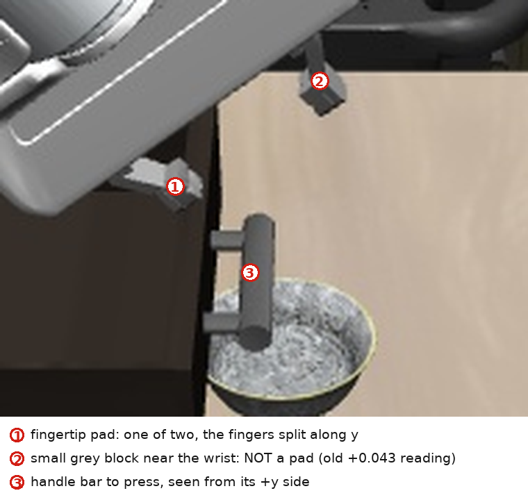

# Control by code

**This file is the method.** The evidence behind every rule is in `REFERENCE.md` (the measured atlas) and `HISTORY.md` (what each rule cost); the per-subtask recipes are in `tasks/`. Read those **on demand** — the in-episode path is: *loop → measure → frame → one recipe → verdict*.

Two budgets, not one: a row costs ~0.5–1 s and a depth call ~1 s, so analysis interleaved with motion burns both. Decide the numbers from the probe, then spend rows.

Numbers here are of two kinds and only one is stable:

* **Rig constants** (§2–§4: camera, action response, gripper geometry). They hold across episodes — but treat them as hypotheses. Every one has been wrong by as much as 4 cm, and the error always surfaced later as a plausible-looking failure (pads 3.5 cm high ride over a drawer rim; pads 1 cm low grasp above a lip). A zero-step depth call re-measures any of them: do that in the probe and write down which one you checked.
* **Placement numbers** (where the cabinet, drawer, handle and objects are). Drawn at random per episode, never transferable. What transfers is the *anatomy* and the *derivations*.

## 0. The loop

1. `status` → `task.language` **to the last word** (it chooses the subtask file, §9) and `episode.remaining_episode_steps`. The episode is already open; do not try to open it.
2. Write `code/<name>/controller.py` with `main(ctx)` **before** spending rows, starting from `code/lib/rig.py`. A file written after the arm has finished is a transcript, not a controller. One `ENTRY` per stage, each runnable alone *and* chainable (`ENTRY=run`).
3. Run it through the wrapper, one entry point per stage, and tee every run: `ENTRY=probe python3 code/lib/run_controller.py 2>&1 | tee experiments/logs/probe.log`. A re-run on the same episode picks up where the last one stopped, so a failed stage costs a re-run rather than an episode.
4. **Probe (0 rows)** — one `libero_depth` + one `frame.jpg`, and the list in §1. Then make four decisions, all 0 rows and all *measurements*:
   * **the corridor** — the recipe transfers, the corridor does not (§3);
   * **which rim or side to grasp** — the hand is a plate, not a finger (§4, §5);
   * **the drop point / target region** — a container's mouth is its walls, not the visible floor (§7), and its *free air* is what the hand must fit (§7);
   * **the reach** — the pad bottom's minimum at the object's xy. The envelope is a surface, not a point: measured, 0.958 at x −0.335 but 0.99 for x ≤ −0.40 (§3, `REFERENCE.md` §A3). An object beyond it cannot be grasped by *any* geometry, so the fix is to bring the object into reach (a drag, `tasks/grasp-cylinder.md` §Recovery), decided in the probe and not after two failed closes have pushed it further out.
5. **Buy the verdict before the motion.** When a motion's outcome has no in-loop signal — a pull, a hook, a push to a stop, a pinch — the deciding measurement costs 0 rows and the motion 20–35: score it as a predicate first, then run a 4–6-row probe **of the exact motion you intend**. A probe with a different bias is a different experiment (a z-held +y probe read 0.000 m at the very pose the biased burst pulled 4.4 cm from).
6. Spend rows. Stop the script before calling a robot tool yourself; a hand-issued `libero_step` is for a short correction, then edit the controller and re-run. Print `remaining_episode_steps` after every stage and give each stage a hard cap (§10).
7. **Score the goal predicate from depth, then `finish`.** It is one shot and its verdict is the only spec you will ever see (§8).

A failed attempt is not the end of the episode. While rows remain, a stall means *that contact* did not work: name what touched, change the direction, height or wrist roll so the next frame is visibly different, and run another stage. Do not call `finish`, and do not repeat the pose that just stalled.

**Keep an identity ledger.** Depth reports positions, not names, so identical objects that swap places look exactly like success. Every stage prints all candidate blobs (0 rows), a stage that ends somewhere unexpected re-runs the object search before touching anything, and the object that must *not* move (the destination, the closed drawer, the source spot) is the reference you check against. Pick the destination by distance to the ledger, **never** by a measured height (two bowls 0.1 mm apart in rim z were 22 cm apart in x). Details: `tasks/stack-bowl.md` §Identity.

**Keep a pose ledger too, and gate every stage on a measured predicate.** A contact that misses is not a no-op, it is a *displacement*: one close that squeezed a free bottle out pushed the bottle 5 cm and the arm 3.4 cm, and the next one took the bottle to 24 cm from where the plan believed it was — past the arm's reach, which is what actually ended that episode. So after any contact the object's pose is stale: re-probe (0 rows) before re-aiming, and rebuild the aim from the new depth, never from the pre-failure plan. The same discipline for stages: `rotate_to`, `goto`, `close_grip` and `descend_*` all *return* their verdict, and a stage that comes back short — a rotation at `rot_err` 0.60, a descent 10 cm high — must not hand over to the next one. That one gate is the difference between a re-run and an episode: a 136° rotation returned 34° short, the descent after it ran anyway, and every later row was spent on the consequences.

## 1. Measure first (0 rows)

One `libero_depth` + one `frame.jpg` contains every number below. Save it — `rig.snapshot(ctx, tag="probe0")` — and re-analyse offline: five depth calls interleaved with motion is how the two budgets run out together.

**Read an unfamiliar scene as five layers, in this order: support surfaces → vertical faces → free air → objects → the arm's own silhouette.** Every scene in this suite is those five and only the numbers move. The *support* z-modes say where anything can stand (one table here, a table plus two drawer floors there); the *faces* per axis say which way a chest opens and where a panel is; the *free air* — a column grid, 1–2 cm cells — says what a descent can pass through, which is never the mouth you can see; each *object* needs a colour class **and its distractors' class printed next to it**; and the *arm's silhouette* is the shape that has to fit (0.2 m long, 0.16 m tall with the wrist down). A number that cannot exist — a 0.215 m "length" for a 0.156 m bottle — is a mask bug, not a scene fact, and the fastest way to find it is to print the blob's mean RGB beside the mean RGB of the biggest thing it might have merged with.

| measure | with | why it decides |
| --- | --- | --- |
| table plane = the height origin | the **mode** of z over open table, not the biggest plane | loose objects contribute their own buckets |
| pad offset | `s.pads()` at four box sizes, `eef_z > 1.10` only | every contact height (4 cm = an episode) |
| jaw-pair offset | `s.jaw()`; the gap must equal `2·gripper_qpos` | `eef_pos` is not the centre of the fingers |
| the hand's plate | `rig.hand_slab(s)` | what a grasp and a push actually sweep |
| the object | blob above the table → `rim_plane` + `bowl_height`, or top face + footprint | grasp pose, carry offsets, set-down height |
| the target | its own plane; for a named region, its own centre | §8 |
| a container's mouth | `rig.mouth_walls` + the free-column test | §7 |
| a container's **free air** (not its mouth) | `rig.box_free_columns` at 1–2 cm, plus the z band of every overhang above it | a drawer with a closed drawer above has a 21 cm mouth but a usable window only as tall as the gap between the bars; the hand is 15.7 cm tall |
| the hand's vertical stack | its own underside per z band, `eef_z+0.043 / +0.075 / +0.10 / +0.135` | decides which overhang stops it and at what `eef_z`: pads, a 1 cm bar, a 3 cm block, a 7.6 × 20 cm box — all 20 cm long along the jaw axis |
| the object's colour class **and its distractors'** | the blob's mean RGB beside the mean RGB of the largest thing it could merge with | a "dark" threshold merged the dark-green bottle into the black cabinet and returned a 0.215 m "length"; G−R ≥ 4 separated them (bottle 8, robot grey 1) |
| the corridor | `rig.above_table_map`, `s.arm_yz()`, `s.arm_low()` | what a descent or a grasp sweeps through |

**Two rig checks, both free.** The table unprojects to one flat plane (z ≈ 0.95 here — the scene's height origin), and the white wrist cylinder at the start pose unprojects to x ≈ eef x, not 0.68 m away. If either fails, every number you derive is wrong.

**Masks.** `libero_depth` renders the scene *including the arm*, so exclude the robot from every scene mask — **by height, not by distance**: the arm's lowest point is the pad bottom (`eef_z + 0.043`), so a tool held above a mask's z ceiling cannot be in the window at all, while a 3-D `|p − eef| > r` filter deletes the *object* whenever the arm parks over it (a bowl 15 cm below the tool measured 0.164 m from the eef and vanished from every search). `Scene.arm` is *achromatic and `mean > 70`*: it holds the dark pads, the grey handle bars, a speckled bowl, a bright drawer interior and pale counter tops — so `~arm` is right for **planes** and wrong for objects, walls and bars. Colour classes, and the traps in each: `REFERENCE.md` §C, §D.

**`~Scene.arm` leaks about a tenth of the robot's own pixels** (its shadowed and dark parts), and that is fatal for a height field: one leaked pixel at `eef_z+0.23` faked a 1.4 m obstacle and turned a clear grip pose into 300 "blocked" points. Whenever the mask must *exclude the robot* and *include a coloured object* — a corridor height field, an object class — test **chroma** instead: the robot is grey to within `max−min ≈ 2` (measured (37,38,36) at a grasp pose), so `max−min > 30` is scene, and the object's own class is then chosen inside that.

## 2. Frame — camera, axes, and which way "out" is

* `fx = fy ≈ 618`, `cx = cy = 256`; depth is metres **along the optical axis**, not the ray. `camera_to_base`'s rotation is right and its translation is not: keep the 3×3, replace `t` with `(0.637, −0.012, 1.659)`.
* **Image axes come from the matrix.** `:3,0` is the world direction of image +u and `:3,1` of +v (down). Here **+u = world +y** and **+v = (0.63, 0, −0.78)**, so "lower in the picture" is mostly **+x and −z** — enough to ruin a height estimate. The optical axis is (−0.78, 0, −0.63): the camera looks toward −x and −z. Convention: **+x is "in front", −x "at the back"**, so a spatial qualifier in the instruction is a *selector*, not a placement hint.
* **+u has no y component, so every +y-facing plane is seen edge-on.** A drawer front is a 1 mm bin with 600–2 000 px, not a fat face. The **bars**, standing proud, are what identify a drawer.
* **Which way do the drawers face? Measure it.** `rig.drawer_axis(s)` returns the axis, the OUT sign `S` and the fronts' plane; drawers always open toward the camera side (KITCHEN_SCENE2 is `S = +1`, fronts y −0.229; KITCHEN_SCENE4 is `S = −1`, fronts y +0.216). Write every relation in the out-coordinate **`u = S · coord[axis]`** and the geometry transfers untouched.
* **On a mirrored chest the sign-hardcoded helpers do not fail loudly — they return plausible numbers 0.15–0.30 m out.** `front_face_y` takes max y, which on a −y chest is the *closed* plane: it called a 15 cm-open drawer "front-most", with no error anywhere. Use the sign-agnostic layer (`front_face_on` / `handle_bars_on` / `panel_home_on` / `face_bins` / `hook_quat_toward`). The seven specific traps: `REFERENCE.md` §B4.

## 3. Motion — what answers, what stops, and the three-row test

Per row at |a| = 1: x 0.009–0.013 m, y 0.011–0.012, z 0.012 (0.006 at 0.5), rotation 0.06–0.09 rad. A 12 mm position error already saturates the command, so a servo loop is **bang-bang per axis**: use the rate only to size a move and let the loop absorb the error. A 2 rad wrist error costs ~25 rows; the stride collapses 2–5× when the target is far across the cabinet and roughly halves under a heavy payload.

**Servo the quaternion every row** — the wrist drifts, and rolling it while translating moves the pads far more than the position error suggests:

```python
def qmul(a, b):
    ax, ay, az, aw = a; bx, by, bz, bw = b
    return np.array([aw*bx + ax*bw + ay*bz - az*by, aw*by - ax*bz + ay*bw + az*bx,
                     aw*bz + ax*by - ay*bx + az*bw, aw*bw - ax*bx - ay*by - az*bz])

def rotvec_err(q_cur, q_tgt):          # world-frame rotation vector, xyzw
    qe = qmul(q_tgt, np.array([-q_cur[0], -q_cur[1], -q_cur[2], q_cur[3]]))
    qe /= np.linalg.norm(qe) + 1e-12
    if qe[3] < 0: qe = -qe
    s = np.linalg.norm(qe[:3])
    return np.zeros(3) if s < 1e-9 else qe[:3]/s * (2.0*np.arctan2(s, qe[3]))
```

Wrist-down is about `(0.9995, −0.010, −0.029, 0.002)` xyzw (`rig.Q_DOWN`): w near 0 with a vector near 1 is this pose, w near 1 is not. Measure orientation error as `2·acos|q·q0|`.

**A rotation is its own stage.** OSC_POSE trades orientation for position: a 90° pitch commanded *while translating* stalls with a 0.44 rad error that then *grows* as the position error stays large. Rotate **in place** first (rotation-only rows, `action[3:6] = rotvec_err/0.30`), re-pass until `‖rot_err‖ ≤ 0.04`, re-read `eef_pos` (a rotation-only row walks the arm 4–8 cm), then translate. `rig.rotate_to` does exactly this; `rig.goto`/`rig.servo` **cannot** rotate — they gate on position and return on row 0.

* **Budget the rows from the angle and *verify* the result.** Measured (task 26, 2.20 rad): **35 rows**, i.e. 0.063 rad/row ≈ **3.6°/row — so 90° ≈ 25 rows and 180° ≈ 50**, not the 18 rows a 0.09 rad/row estimate implies. A `rotate_to` that hits `max_rows` returns a big residual and says so; a caller that descends anyway gets the failure below.
* **An open hand sweeps a 0.2 m disc.** The hand's footprint (±0.10 along the jaw axis, at `eef_z+0.04…+0.20`) rotates with it: on task 26 that swept a lying bottle 5 cm and began the slide that ended with it 24 cm out of reach. So a rotation is not done *at the work pose*: **park where the obstacle map is empty within 0.2 m at those heights, rotate there, then translate.** Two stages, in that order — the opposite order costs the object.
* **Rotating an open hand is also how a grasp pose gets *made***: rotating over the object you are about to pinch is the one place the sweep does damage, so the parking pose should be at least one hand-length away in x or y, not 3 cm above.

**A long descent cannot be one goto.** Measured: 0.23 m ran 11–13 mm/row for 11 rows, then `‖rot_err‖` went 0.026 → 0.120 over six more and the arm froze at 0.6 mm/row **10 cm above its target** — the orientation trade-off alone, not a contact. Descend in **≤3 cm slices with a rotation-only pass between them**, then re-read `eef_z` (a rotation-only row moves it ~1.8 cm).

**When motion stops, run three one-row tests in this order**: `dz = +1`, then `droll = +1`, then `dx = ∓1`. What answers names the cause — and the fix is different for each:

| what answers | cause | first move |
| --- | --- | --- |
| nothing, yet the wrist still rotates, and `+z` is dead too | **standing on a face at `eef_z + 0.082`**: a bar top, the counter, a drawer rim, a table object | find that face (`planes(axes="z")`); a kick cannot break a contact |
| `+z` moves, `−z` does not | **controller freeze** — a row goes inert at particular heights and returns at the same spot | row-alternating roll kick **on top of** the quat servo (an undoctored `+0.45 droll` wound 2.1 rad once and looked exactly like a blocked arm) |
| `+z` moves, one horizontal axis inert below x ≈ +0.02, `j4 ≈ −0.07` | **stretched arm** | **rise first** to z ≈ 1.35–1.42 at the *current* xy (folds j4 to −1.5…−2.0), cross in xy, then descend |
| `+z` alive, `‖rot_err‖` climbing, one axis inert | the quaternion servo is starving the position servo | rotate in place to ≤0.04 rad, then translate |
| `+z` alive, `‖rot_err‖ < 0.05`, **nothing under the pads in the depth**, `arm_low` clean | **short reach near the base**, not a contact | shift **−x** (the reachable pose measured (−0.018, 0.10, 0.97); the jam region is x +0.02…0.03, y 0.10…0.16, z 1.11…1.25) |
| the descent stops while the eef **drifts along one horizontal axis**, and nothing is within 4 cm of the fingers | the **hand plate** resting on clutter *behind* the eef (0.15–0.2 m behind, ~1.5 cm below) | change the corridor, not the height — a 5 mm sweep moves a 0.19 m lever by nothing |
| x/y jam while z still moves, inside an open box | **wedge**: the pads went over a rim | `+z` above the rim, out of the mouth, re-approach lower |
| the descent goes **UP** while commanded down, and the xy residual will not close (task 26: sent to x −0.53, `eef_z` 1.172, it rose to 1.209 and stopped 5.5 cm short in x; the same xy held at z 1.19) | **the target xy is outside the reach envelope** — OSC trades the error between axes, so the arm slides along the envelope and the z servo loses | move **toward the base** (+x here) until the xy closes; the z then follows. It is a *surface*: pad bottom 0.958 at x −0.335 but 0.99 for x ≤ −0.40 |

Gate any stall detector on `‖rot_err‖ < 0.10`: "no motion" is the normal state of a rotation row.

**A push has no force signal: servo it in metres and read the residual.** 0–1 mm left means it went through empty space; 10–12 mm is contact. A push written as a row count (`rows=3`) moved 12 mm where the stride was 1.4–6 mm/row — +1.3° of knob in 215 rows. Before lifting off a contacted face, **back off ~2 cm along the push axis**: lifting with the pad still on a fin dragged it 7° backwards. And never reverse the push direction on a weak result (a "no motion ⇒ reverse" rule fired while the fin was turning 1.4–2.9°/cycle and cost 25°).

**The corridor is per-draw, and it is not a height.** The recipe transfers; the space in front of the target does not. Before the first row: `rig.above_table_map(s)` names what stands above the table, `s.arm_yz()`/`s.arm_low()` the arm's own ridge, `rig.hand_slab(s)` the hand's plate. Then **descend where the palm is clear → cross horizontally at the working z → descend the last few centimetres.** When a pose has to be *proved* clear rather than eyeballed, run the audit instead of spending rows: a **chroma** height field of the scene plus the arm's own measured silhouette rotated into the candidate **eef**, every arm point tested at its own z (`code/bottle26/audit.py`; `tasks/grasp-cylinder.md` has the two contracts that decide whether it is honest — the field must contain no robot pixels, and the pose must be the eef, not the jaw).

## 4. Gripper geometry — the four numbers that decide every contact

All four are measurable from one depth call at the start pose, for 0 rows.

1. **Pad bottom = `eef_z + PAD_DZ`** (`PAD_DZ ≈ 0.043`; readings 0.0405–0.0470, and 0.0410 on the last episode). The gripping band is `eef_z + 0.043 … + 0.065` — ~2.2 cm, not 4. Measure it with the **four-box ladder** (0.045 / 0.050 / 0.060 / 0.075) at `eef_z > 1.10`, keep the flat agreeing reading — and do **not** re-derive it at the grasp pose (an 18 mm stick between the pads makes the same box read +0.033) or from a low eef, where the reading is the raised surface or the table itself (a *negative* offset, or a jaw gap of 0.09–0.11, is that tell).
2. **`eef_pos` is not the centre of the jaws.** The pair sits `(−0.014, −0.015)` from it, good to ~5 mm — more than a rim wall is thick. Sanity: the gap must equal `2·gripper_qpos`.
3. **The hand is a ~0.2 m plate centred on the eef**: 0.111 m ahead (the front finger only ~0.07), 0.09 m behind, at `eef_z + 0.07 … +0.13` — and it moves with the pose (the underside's low edge read 0.082 at the home pose, 0.059–0.086 at a grasp pose), so read it per pose with `rig.hand_slab`. Consequences: a wrist-down grasp needs ~11 cm of clear space on the finger side **and** ~9 cm on the other, at 8–13 cm above the grasp height — which decides which rim you can pinch (§5); a descent dies at `eef_z + 0.082` (§3); and a horizontal push is made by the **hand's face**, never by the pads (4.2 cm deeper and 4 cm higher than they are). **Its vertical stack, measured per z band (task 26, home pose):** pads `+0.043…+0.065`, a 1 cm-wide bar `+0.075…+0.095`, a 3 cm block `+0.10…+0.14`, a 7.6 × 20 cm box `+0.135…+0.20` — the hand is **15.7 cm tall** and **20 cm long along the jaw axis** at every level above the pads. That is the shape a container must accept: a drawer whose usable air is shorter than 15.7 cm cannot be entered deeper than that window allows `eef_z`, however wide its mouth is (§7).
4. **`gripper_qpos` cannot confirm a pinch.** The jaws close at only ~0.0023 m/row, so hold the pose until they settle (`rig.close_grip`); 0.001–0.002 is "closed on nothing" (a 3–4 mm rim settles near 0.004 too), ≥0.01 is something thick, and a held object can drag the jaws 0.0049 → 0.0023 while it hangs. On a flared or wedged wall `gq` is not a thickness at all (a pan lip held a whole episode at 0.0098). Judge a grasp by **the object leaving its own spot**.

**A pitched wrist breaks all four.** At the hook pitch `pads()` reads the *palm* (+0.0586, or −0.02 when the table gets into the box) and the jaw pair sits (−0.029, −0.021) to (−0.044, −0.016); the finger's top is `eef_z + 0.0197` — about half the wrist-down `PAD_DZ` — and it is *measured* by a 5-row ascent (`rig.finger_top_offset`), never rotated. For any pitched pose, measure the offsets **at that pose, with the arm clear** — `tasks/open-drawer.md`.

## 5. Grasp

**Which rim — 0 rows, and it is a measurement.** The jaw axis and the hand's back are the same body axis, so **every rim has exactly two pinches**: the plate pointing OUT past that rim, or IN over the object. `rig.rim_grasp_axis(rim, rim_dir, hand_out)` returns the eef, the tool quaternion (it yaws the wrist to any of ±x/±y) and the carried-measurement hint for either. Three of the four candidates on libero_90 task 24:

| rim, plate side | blocked by | measured |
| --- | --- | --- |
| −y rim, plate OUT (`rim_grasp_target(side=-1)`, the default) | leaning boards 3.5 cm behind the rim, 12–25 cm tall | the plate stood on their top edge at `eef_z` 1.1149 and 0.9923 |
| +y rim, plate IN (`side=+1`) | the open drawer's front panel: top 1.033 against the plate's 1.024 | ~9 mm interference → a stall 1 cm short |
| **+x rim, plate OUT** (wrist yawed +90°) | nothing — the table was bare there | **worked**: `gq` 0.0040, object off the table |

The yaw carries into the place pose: the object then hangs ~7 cm from the eef along the pinch axis, and every carried measurement needs the **rotated** jaw offset (`rim_grasp_axis` returns `jd_world`).

**A rim pinch is decided by ±2 mm of radial aim.** A bowl's lip is only 3 mm wide (a fitted `R` is the lip's *mid* radius; the wall below it ~5 mm), so the jaw pair's centre must land on the wall's mid-radius. Two closes aimed 4–5 mm inside it settled at `gq` 0.0017–0.0029 — the pads met each other — and **shoved the bowl 1.8 cm**: a free object is simply squeezed out of a parallel-jaw pinch when one pad leads (fix: a backstop, or a better aim). The recipe:

1. **align in xy at the grasp height before closing** — a descent saturated in z drifts ~2 mm/row horizontally, and two attempts landed 4.4 mm out (one pad on the wall's outer face, one in air);
2. **sweep the inset** (0.0015, then 0.0035) instead of re-aiming the same pose;
3. `close_grip` until settled; **success band `gq` 0.0026–0.0065**; ≤0.0022 is the pads meeting;
4. **prove it in 5 rows** — lift 4–5 cm, one depth call, require `object_gone(source_xy)` (the blob's `zmax` collapse) **and** `gq` in the band. Do not buy that verdict with a 16-row lift and a re-grasp, and do not let a ring fit veto it (§6).

**A flat object on the table is a straddle, not a rim.** Pad bottom ~6 mm above the table (`eef_z = table + 0.006 − PAD_DZ` ≈ 0.913, i.e. the eef *under* the table plane, which is legal), jaw pair on the narrow dimension, straight down, `close_grip` until settled, lift 0.11 m, then verify the old spot is **empty** and that the picture agrees. A box taller than the 2.2 cm band aims the pad bottom at `table + 0.013` so the band covers its top 1.5 cm.

**A lying round object — a bottle, a can, a rolling pin — is a straddle ACROSS its axis, with the band ABOVE the axis.** Yaw the wrist until the jaw axis is perpendicular to the object's own axis (`yaw_quat(Q_DOWN, object_angle − 180)`; the +0 variant is the mirror and may be the blocked one — audit both, §3), aim the jaw centre **on the axis** — fit it from the top **ridge**, not the blob centroid, which sits up to 1 cm off because only the upper band is visible — and put the pad band's centre **6–8 mm above the axis**, i.e. `eef_z = axis_z − 0.048`. A band centred *below* the axis squeezes the object **up**: measured, a band 3 mm low closed to `gq 0.0028` on nothing and threw the bottle up into the fingers' hooks. Above it, the same close presses the object into the table. Full recipe, including what a 34°-short yaw does: `tasks/grasp-cylinder.md`.

**A close that misses is not free — it moves the object.** A parallel-jaw close on a free object it did not centre *ploughs* it: measured 5 cm of object (and 3.4 cm of arm) in one close, 24 cm over two, which is more than this arm's reach margin. So the sequence after a miss is: **re-probe (0 rows) → recompute the aim from the new depth → change the geometry that was wrong (the yaw, the band's height), never re-close on the old plan.** And if the object ends up outside the reach envelope (§3), *drag it back* with the open jaws — `tasks/grasp-cylinder.md` §Recovery — rather than treating the episode as lost.

**A lip pinch is a pivot, not a clamp.** The payload hangs ~17° off the fingers' axis (the "17° lock": tool 2.6° → bowl 16.9°, tool 17.1° → bowl 1.2°), so **level the object by holding the tool tilted** (`rig.rotate_to`, then pass the achieved `q_hold` to every later row — a later goto with `Q_DOWN` re-tilts it in one move), and re-measure `object − eef` after every contact (a 5 mm lip pinch let a bowl walk ~1 cm inside the grip over 40 rows).

## 6. Carry and place

* **Carry high enough that the payload's bottom clears the destination's rim** (eef ≥ rim + 0.09 is the safe default; the height that matters is the *object's* bottom, not the eef's).
* **Aim with the MEASURED offset, never with `R`.** A rim or lip pinch hangs the payload at a measured `d_xy`, `d_z` — on task 24 that was `(−0.0706, −0.0102)` / `+0.0546`, i.e. 3 cm further from the pads than `R`, so a plan built on `R` is 3 cm out. `rig.measure_held` prints `|centre − jaw|` against `R` so you can see which kind of hold you have.
* **A grip is not where you aimed, either — place by the MEASURED centre of the payload.** A pinch that lands off-centre leaves the object hanging 4–5 cm from the jaw (task 26: gripped near its base, 4 cm off, after the close pushed it), so the place target is `desired_centre − (measured_centre − eef)`, re-derived after **every** rotation — rotating the wrist swings the offset round with it.
* **Descend on the measured base, in ≤3 cm slices**, recomputing from the fresh `d_z` every step (that offset drifts 0.053 → 0.074 inside one carry): `eef_z = base + h − d_z`. Guard the command at `base ≥ support + 3 mm`, and **never release on a height you have not measured** — a loop that hit its row cap and then opened the jaws dropped a pan onto a plate's front edge.
* **Contact test — the only in-loop evidence a held object gives**: press ~1.2 mm and compare Δbase with Δeef. Free ⇒ the base follows the arm to 0.1 mm; resting ⇒ the base moves 0.5–0.7 mm less and the destination takes the load. The eef's own stall is *not* a sensor: a lip pinch slips.
* **Release with a small `+z` bias** — a row of zeros is not a hold (its gripper field is 0 = mid-range and it drops what you are carrying). Retreat `+z` first, then out along the opening direction, then down.
* **Release symmetrically when the last centimetres are a drop.** Open both jaws at `dz = 0` (no `+z` drag, no sideways bias) so the fall has no lateral impulse, and let the payload go only where its whole footprint is inside the mouth (§7). A *planned* vertical drop of ≤ 10–15 cm is cheap and safe — MuJoCo's default contact adds no restitution, and task 24's bowl free-fell 15 cm, landed upright and read `floor + h` to 0.5 mm — while a 40-row descent the geometry forbids is not.
* **A payload much bigger than the jaws hangs tilted**: measure the tilt, `level_quat` + `rotate_to` it out, and aim the descent at its **lowest point** (`base − R_base·sin tilt`), not at its base.

## 7. Containers — putting in, and closing

**The mouth is not the visible floor.** A bright drawer interior gives no floor plane at all, and the near wall hides several cm of it: on libero_90 task 24 the visible floor spanned 15 × 12 cm while the box's inner walls stood at x −0.1315 / +0.0805 (a **21 cm** mouth) and its back wall at y **+0.2286** — *past* the fronts' plane, because the box slides into the cabinet. Measure the walls with `rig.mouth_walls` (**no** arm exclusion: the interior is inside `Scene.arm`) and read the floor's extent as an inner bound: fine to aim at, wrong for "it will not fit".

**Drop deep**: at least 5 cm behind the panel's inner face, so the finger bottoms descend inside the box and nothing lands on the panel's top face. Then check three things:
* **the free-column test**, not the floor plane's extent: a column reading the floor is free, the rim is a wall, and the *table* z means the sight line passed under the box;
* **the drawer ABOVE overhangs the mouth** — a closed drawer's bar read 1.067–1.074, 3–4 cm above the open box's rim and inside its back half, exactly where a wrist-down hand's plate arrives;
* **arm reach into the box**: a descent can die at `eef_z ≈ 1.11` with nothing under the payload (§3, short reach). The reachable direction is −x, so aim the payload 1.5–2 cm off the centre toward −x rather than release 10 cm up.

**The mouth is not the FREE AIR either — and the free air is what the hand must fit.** On task 26 the bottom drawer's mouth was 21.2 cm wide with a 13 cm floor span, but the air above it was bounded by the open panel's inner face at y +0.070 (top 1.0339) and by the two *closed* drawers' handle bars standing 3 cm proud at y +0.1851 in two thin z bands (1.0666–1.0735 and 1.1397–1.147). The hand is 15.7 cm tall and 20 cm long along the jaw axis (§4.3), so it cannot thread an 11.5 cm window: the wrist block comes to rest on the upper bar, and the deepest clean `eef_z` is `bar_bottom − 0.135…0.20`. **Derive the placement from that number, not from the mouth:**
* payload bottom at that pose = `eef_z + 0.054 − r`; the residual is a *drop* into the mouth;
* a straight-down drop of ≤ 10–15 cm is acceptable **if** the payload's whole plan view is inside the walls (§6's symmetric release); that is how task 24 finished, and it is cheaper than 40 rows of a descent the geometry will not allow;
* if the free window is short *and* the mouth is shallow for the payload's plan view, rotate the payload while carrying (a 15.6 cm bottle is 14.0 cm across at 44° against a 13 cm free depth, and 4.4 cm at 0°) — at a parking pose, because its 0.1 m sweep is what shoves things (§3).

**Verify with a column GRID, not a ring fit** (`rig.container_top_scan`): every cell reading `floor + h_obj` is the object's top, a cell at the floor is floor, a cell above is a wall or the drawer-above's bar, and the centroid of the first set must land inside the mouth. A ring fit inside a bright drawer is not a verdict — the object and the interior merge into one 4 000-pixel blob ("ring" R 0.075, residual 10 mm).

**Closing a drawer** (`tasks/close-drawer.md`, failure table `REFERENCE.md` §B3): aim the **hand's front face** at the handle bar's z band, never at the panel band, and require `eef_z + 0.082 < bar_bottom`, i.e. `eef_z ≤ bar_top − 0.088`. On a **bottom** drawer that aim lies under the table, so the pusher is the **finger tips** at `z = bar_zc − 0.031`. Push along `−u` with the panel's own plane sampled every ~4 rows (`rig.push_to_stop`), stop when `−6 mm ≤ u_panel − u_ref ≤ +1.5 mm`, and spend one `+z` row to prove the dead rows were the drawer. Verdict on four signals together — the panel's own plane (asymmetric home tolerance), the rim plane's front extent, the drawer-floor plane vanishing, the interior's pixel count collapsing — and treat `home=False` as a veto only when a second signal disagrees.

**Opening** is the mirror image and needs the wrist *pitched* (`tasks/open-drawer.md`): the press height is `bar_z0 − 0.045`, the aim `bar_front − 0.015`, and the verdict is the biased probe (`move_u ≥ 5 mm` **and** `dz_actual ≈ 0`), never the residual.

## 8. Verdicts before `finish`

`finish` is one shot. Score the clause **yourself, from depth**, in the form the clause names:

| clause | the state that is true | the failure that looks like success |
| --- | --- | --- |
| `on(upper, lower)` — a stack | the upper object's **base at the lower object's rim plane, in contact, still held** (−0.75 mm, task 17) | sunk into the mouth (−13 mm) or held 9–11 mm above with no contact; a release tips it (−14.8 mm, 9.7°) |
| `on(x, <named region>)` | the object's **centre** within ~2 cm of the region's own centre | flat on the burner at 0.4° tilt and still False, with the centre 7.5 cm off |
| `in(x, <container>)` | a column grid over the mouth: the object's top at `floor + h_obj`, centroid inside | a ring fit inside a bright box (it merges with the interior) |
| `turnon(knob)` | the fin's azimuth — an angle, mod 180° — with the lamp as a bonus | a *converged rotation* is not a turned knob |

**The close-and-reopen cycle is a condition on replaying, not on the task.** It exists to purge a replayed demo trace from the final state. If you did not replay (there is no demo file), your run is your own work by construction: open once, verify by planes and the picture, and finish — do not spend ~80 rows on ceremony you do not owe.

## 9. Subtasks — read the file the language names

A subtask file does not replace this one.

| the language says | file | the part that transfers |
| --- | --- | --- |
| "put X in the drawer" | `tasks/put-in-drawer.md` | the drawer is already out: a rim grasp plus a carry into the box |
| "put X in the drawer" where X **lies on its side or can roll** | `tasks/grasp-cylinder.md`, then `tasks/put-in-drawer.md` | the jaw axis perpendicular to X's own axis, the pad band *above* it, and the drag-recovery when a close ploughs it away |
| "… and close it" | `tasks/put-in-drawer-and-close.md` | place **then** close, in that order |
| "put X at the front/back", or move an object | `tasks/move-bowl.md` | a spatial qualifier is a *selector* on x |
| "close the drawer" | `tasks/close-drawer.md` | measure the chest's axis and OUT sign first |
| "open the drawer" | `tasks/open-drawer.md` | the one subtask where the wrist must stop pointing down |
| "stack X on Y" | `tasks/stack-bowl.md` | the final state is the verdict — and it is solved: hold it and press |
| "put X on the stove / plate" | `tasks/put-on-surface.md` | a lip-pinched payload hangs tilted; aim its lowest point |
| "turn on the stove" | `tasks/turn-on-stove.md` | the state is an angle; push the fin's thick end, servo'd in metres |

When an instruction names both a drawer to close and an object to move, **close first** and retract clear before touching the object; the exception is the "... and close it" word order.

## 10. Budget and caps

Plan ~200 rows for a grasp + carry + close, ~40 rows per 0.4 m of carry, and 0 for the probe. Give every stage a hard cap, print `remaining_episode_steps` after it, and when a stage passes its cap **stop and change the geometry** — never "one more push". A two-clause task splits the budget (task 21: knob 60–90 rows, pan ~230 → caps of 120 and 300). The run-by-run accounting, and the five mistakes that cost the most: `HISTORY.md`.

**Price a failure, and keep a reserve for it.** On task 26 the ledger read: a 136° rotation **35 rows**, one grasp attempt ~60–80, and one failed close **5–20 cm of object displacement plus ~100 rows** of recovery (re-probe, re-rotate, re-drag it back into reach — 3 cm of drag cost ~60 rows because each burst re-approached from 15 cm up). An episode that ends at 1000/1000 with the object still on the table has spent the whole budget to learn one thing. So: **verify the predicates that are cheap to verify** (a yaw, a pose, a band height — all 0-row depth reads), keep ≥ 25 % of the budget for one recovery, and if the grasp has not verified by ~40 % of the budget, change the *grip geometry* rather than the aim — a different rim, a different yaw, a band that is above the axis instead of below it.

## 11. The library

`code/lib/rig.py` implements this method; `code/lib/run_controller.py` is the MCP wrapper (`ENTRY=<stage>`, `CONTROLLER=code/<project>`, `TAG=`/`ZPRESS=`/`YOFF=`/`DY=`/`DZ=`/`ROWS=`). **Check the wrapper's `ROOT =` line before the first run** — the copy that ships resolved to `code/` instead of the workspace, so `CONTROLLER=code/x` became `code/code/x` and `experiments/` was created under `code/`. Three `dirname`s fix it, and nothing works until it does.

`rig.py`'s docstrings are the short form of each helper; `REFERENCE.md` §D is the long one. Groups: **measure** (`snapshot`, `Scene`, `planes`, `rim_plane`, `bowl_height`, `robust_ring`, `measure_carried`/`measure_held`, `plane_mode`, `objects_on_table`, `above_table_map`, `hand_slab`, `mouth_walls`, `container_top_scan`, `column_max_z`, `box_free_columns`, `colour_class_count`, `axis_from_ridge`, `hand_stack`); **move** (`servo`, `goto`, `rotate_to`, `descend_rows`, `push`, `close_grip`); **grasp and place** (`rim_grasp_target`, `rim_grasp_axis`, `grasp_rim`, `eef_for_base`, `band_for_axis`, `descend_to_base`, `contact_test`, `level_quat`, `base_low`, `object_gone`); **drawers** (`drawer_axis`, `chest_window`, `front_face_on`, `handle_bars_on`, `panel_home_on`, `face_bins`, `bar_zs`, `drawer_band_for_bar`, `push_to_stop`, `push_tips_to_stop`, `hook_quat_toward`, `probe_pull_biased`, `pull_burst`, `hook_press_z`, `bar_front_from_panel`); **knob** (`flat_face_az`, `az_delta`, `red_pixels`). Constants: `Q_DOWN`, `Q_HOOK`, `PAD_DZ`, `PAD_TALL`, `JAW_DX/DY`, `DZ_BAR`.

Two finished controllers to copy the *shape* of the stages from: `code/butter_front/controller.py` (place-then-close, 241 rows, passed) and `code/drawer23/controller.py` (the mirrored chest, 574 rows, with its `descend_smart` (a library-shaped descent in slices) and the three-leg corridor). The rest, with what each one teaches: `REFERENCE.md` §F.


